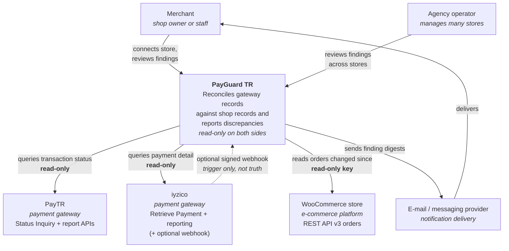
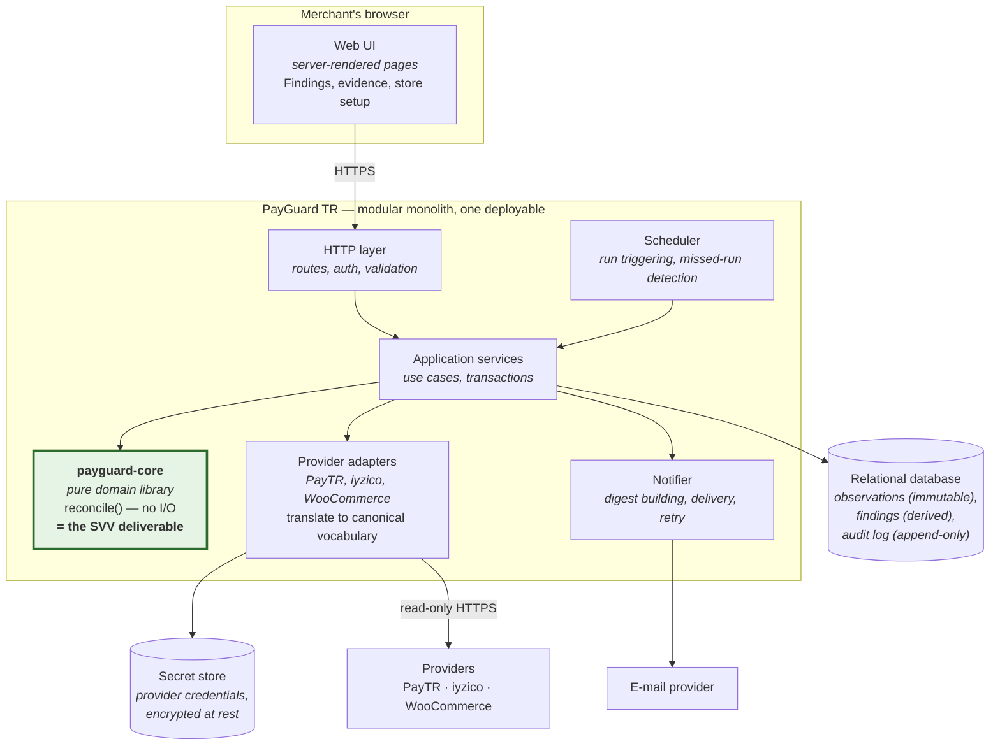
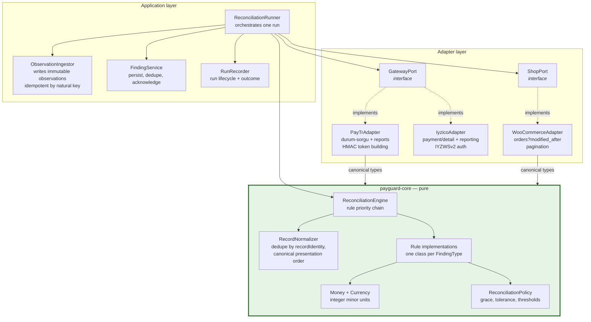
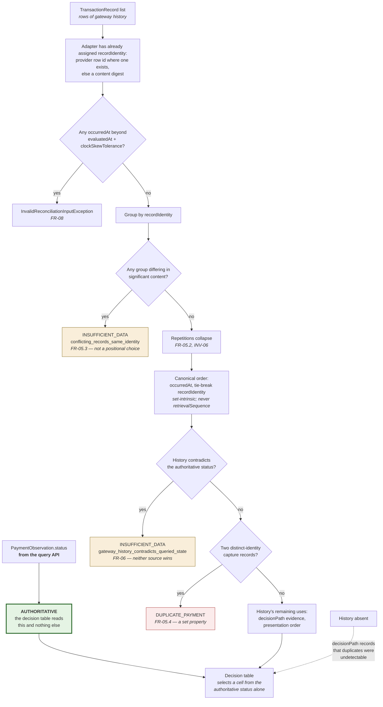
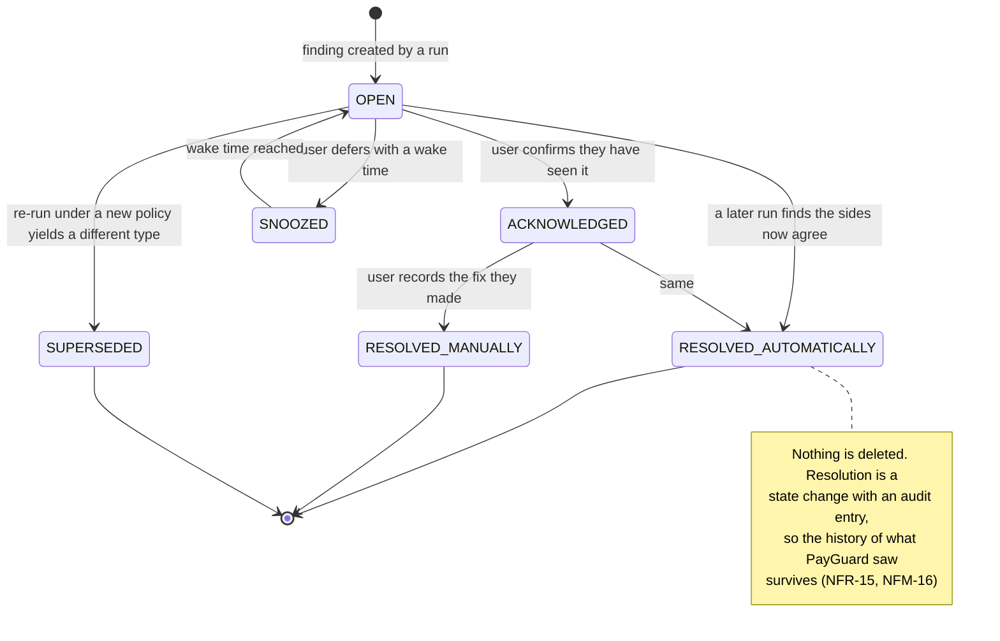
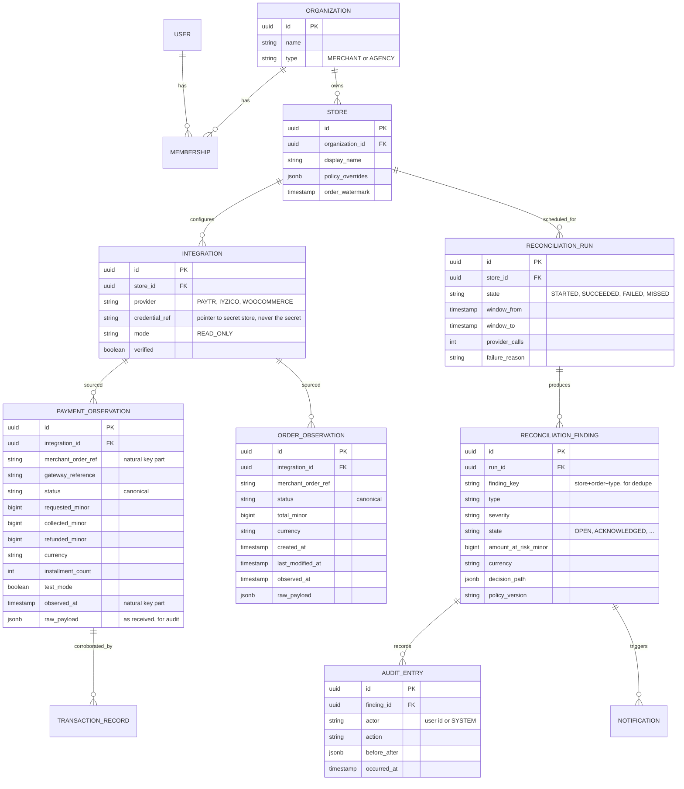

# PayGuard TR — Software Architecture Document

| | |
|---|---|
| Version | **0.3.1** (consistency cleanup; architecture frozen) |
| Date | 22 November 2026 |
| Author | Ranim (architecture), with research assistance |
| Status | Scope A **READY FOR IMPLEMENTATION** · Scope B **NOT READY** — see §13.3 |

**Supporting documents**

- [`provider-capabilities.md`](provider-capabilities.md) — verified PayTR, iyzico and WooCommerce behaviour, and the unknowns
- [`domain-model.md`](domain-model.md) — the four non-interchangeable concepts, one status vocabulary, invariants, glossary
- [`requirements.md`](requirements.md) — functional and non-functional requirements, business rules, the 80-cell decision table
- [`adr/`](adr/) — 16 ADR records, 15 active + 1 superseded (ADR-008)
- [`failure-mode-analysis.md`](failure-mode-analysis.md) — error/fault/failure taxonomy and fifteen scenarios
- [`security-and-threat-model.md`](security-and-threat-model.md) — threats, controls, trust boundaries, KVKK
- [`testing-strategy.md`](testing-strategy.md) — traceability matrix, SVV test design, MVP test types
- [`implementation-roadmap.md`](implementation-roadmap.md) — five milestones with explicit out-of-scope
- [`engineering-standards.md`](engineering-standards.md) — module boundaries, CI gates, review checklist
- [`review-response-r2.md`](review-response-r2.md) · [`review-response-r3.md`](review-response-r3.md) · [`patch-report-0.3.1.md`](patch-report-0.3.1.md) — issue-by-issue responses to the review rounds and the freeze patch

---

## 1. Executive summary

PayGuard TR reconciles what a payment gateway recorded against what an e-commerce shop recorded, and reports
the differences that cost a merchant money.

The architecture rests on four decisions.

**One. The product is a *bidirectional* query-first reconciler, not a webhook receiver.** The research forced
the query-first part: PayTR delivers its notification to a single Notification URL configured in the merchant's
own panel, so PayGuard cannot subscribe without breaking the merchant's shop, and iyzico's webhook signature
verification must be switched on per account by emailing their integration team, so it cannot gate onboarding.

The *bidirectional* part is this revision's main correction. Revision 0.1 swept shop-first only — read orders,
then query the gateway for each — which structurally cannot find a payment whose order does not exist, the very
scenario the product is named for. PayTR's Transaction Detail service takes a date range of at most three days
with **no order reference at all** and returns each transaction's `siparis_no`
([docs](https://dev.paytr.com/en/islem-dokumu)), so gateway-first discovery is documented capability. PayGuard
now runs both sweeps, and because that service carries no status field and a date-granular timestamp, discovery
finds candidates and a second Status Inquiry call confirms them (ADR-014).

**Two. The domain core is a pure Java library with no dependencies, plus a minimal runnable entry point.**
`reconcile(input) → finding` reads no clock, opens no socket and touches no database; a small `main` that runs
built-in scenarios and prints findings makes the academic deliverable independently executable without adding a
single dependency (§5.5). This is not an academic convenience that happens to satisfy
the assignment — it is the correct design for a system whose value is the correctness of a judgement, and the
assignment's constraints (Java, JUnit 5, no GUI, no database) happen to describe exactly that module. The same
code is the 24 November deliverable and the product's decision engine.

**Three. Observations are immutable; verdicts are derived.** What a provider said at a moment in time is a
fact and is never updated. Findings are recomputed from facts. This makes every finding explainable from
stored data without re-querying a provider, lets a policy change be re-run without rewriting history, and
turns "why did PayGuard say that?" into a query rather than an investigation.

**Four. PayGuard never moves money.** No refund, capture or cancel endpoint appears in the codebase, even
though PayTR's credentials would permit `/odeme/iade`. The product's job is to tell a human what happened. An
automated financial action is a different product with a different risk profile, and the MVP vocabulary has no
`AUTO_REPAIR` value for that reason.

**Five. One source answers each question, and a disagreement is reported rather than resolved.**
`PaymentObservation.status`, from the provider's query API, **is** the gateway state the decision table reads.
Gateway transaction history is evidence: it can reveal a second capture, populate the decision path, and order
a display, but it can never change which table cell is selected (INV-13). A webhook is a run trigger and does
not enter the core at all. Where the queried status and the history are mutually impossible, neither wins —
PayGuard reports `INSUFFICIENT_DATA` with the contradiction recorded, because two endpoints of one provider
disagreeing is something it can observe but not resolve (ADR-016).

**A sixth, which is really a lesson: a verdict must be a function of the merchant's world, not of PayGuard's
own operational history.** Three defects found across two review rounds were instances of violating it. The
grace period was computed from the moment PayGuard *retrieved* a record, so every poll reset the window and
more monitoring meant less detection. The record tie-break used retrieval order, so the permutation-invariance
invariant the document asserted was unenforceable by its own ordering rule. And a zero `amountAtRisk` demoted
serious findings, conflating "no money at stake" with "we could not work it out". All three are now invariants
with tests (INV-08, INV-11, INV-12, INV-13).

**What is not yet established.** No customer has paid for this and the frequency of the problem is unmeasured.
The blocking *technical* unknown from revision 0.1 is resolved: independent discovery is documented. What
remains unverified is discovery's precision — whether its transaction date ever carries a time, and whether
non-completed transactions appear in it at all (UNK-09, UNK-10). Both are answerable in one sandbox session,
and neither blocks the academic deliverable.

---

## 2. Product and system context

### 2.1 What problem, for whom

A shopper pays 1,250 TRY. The gateway captures the money. The shop's order stays unpaid, or never appears.
Nobody notices until the customer complains, and by then the merchant has either lost the sale or shipped
nothing while holding the money. The merchant's current detection method is a customer email.

Primary users: small and medium Turkish online merchants, and the agencies that build and maintain their
shops. The agency is the more interesting buyer because one agency has the pain across many stores at once.

### 2.2 System context (C4 Level 1)



Two things to read off this diagram. PayGuard sits beside the merchant's checkout, never inside it, so
PayGuard being down cannot stop a sale (NFR-08). And every arrow into a provider is read-only, which is the
architecture's main safety property.

### 2.3 Stakeholder concerns

| Stakeholder | Primary concern | How the architecture addresses it |
|---|---|---|
| Merchant | "Does it find real money, and will it bother me with noise?" | Grace period and instalment-aware amount rules exist specifically to suppress false positives (FR-02, FR-04) |
| Merchant | "Can it break my shop or my payments?" | Read-only credentials, no mutating endpoints, outside the checkout path (NFR-08, NFR-12) |
| Agency operator | "Can I see all my clients at once?" | Per-store isolation with an agency aggregation view (FR-30, though unvalidated) |
| Payment gateway | "Is this integration abusive?" | Bounded call volume per run, rate limits respected once known (NFR-19) |
| SVV examiner | "Is the testing real and well-designed?" | A pure total function with an 80-cell decision table and explicit invariants is unusually amenable to EP, BVA and decision-table testing (see `testing-strategy.md`) |
| Future engineer | "Can I add a gateway without breaking the rules?" | Adapters translate to a canonical vocabulary; rules never see provider strings (NFR-17) |
| Ranim as founder | "Am I building something people want?" | The architecture is explicit that this is unvalidated, and Milestone 1.5 is validation before the MVP build |

---

## 3. Scope and assumptions

### 3.1 Three scopes

| | Scope A — SVV core | Scope B — commercial MVP | Scope C — platform |
|---|---|---|---|
| Deliverable | Pure Java library | One deployable service | Multi-tenant SaaS |
| Deadline | **24 Nov 2026** | After validation | No date |
| Gateways | None (data passed in) | One | Several |
| Platforms | None | One (WooCommerce) | Several |
| Persistence | None | One relational database | Same, partitioned |
| Users | None (library) | Merchant + agency | Organisations, roles |
| Reconciliation | Function call | Scheduled runs | Scheduled + event-triggered |
| Corrective action | None | None (report only) | Approval-gated, if ever |

The core is identical across all three. That is the point of ADR-002.

### 3.2 Assumptions, stated so they can be falsified

| ID | Assumption | If wrong |
|---|---|---|
| AS-01 | Paid-but-unfulfilled orders occur often enough that a merchant will pay to detect them | The product has no market. **This is the central unvalidated assumption** |
| AS-02 | Merchants will share gateway credentials with a third party | Onboarding fails; would need a merchant-hosted agent instead |
| AS-03 | A 15-minute grace period separates real discrepancies from eventual consistency | Tune from pilot data; the parameter exists precisely because the value is a guess |
| AS-04 | Polling at a per-store interval is within provider rate limits | UNK-01, UNK-02 must be answered; design may need event-triggering |
| AS-05 | An agency will pay more than an individual merchant | Pricing model changes, architecture does not |
| AS-06 | WooCommerce first is the right platform choice | Adapter design means a different platform costs one adapter |

---

## 4. Container architecture (C4 Level 2)



The green box is the only part that exists by 24 November. Everything around it is Scope B.

Dependency direction is strictly inward: HTTP → application → core. The core depends on nothing. Adapters
depend on the core's vocabulary, not the reverse. A change to PayTR's API cannot reach the rules.

### 4.1 Container responsibilities

| Container | Responsibility | Explicitly not responsible for |
|---|---|---|
| Web UI | Present findings and their evidence; store connection | Any reconciliation logic |
| HTTP layer | Authentication, authorisation, request validation, idempotency keys | Domain decisions |
| Application services | Orchestrate a run: fetch, persist observations, call core, persist findings, enqueue notifications | Knowing any provider's format |
| **payguard-core** | Classify one payment/order pair | Fetching anything, time, storage |
| Provider adapters | Call provider APIs, verify signatures, translate to canonical types, enforce rate limits | Deciding what a discrepancy means |
| Scheduler | Trigger runs per store, detect runs that did not happen | Running the reconciliation itself |
| Notifier | Batch findings into digests, deliver, retry, record delivery | Deciding severity |
| Database | Durable observations, findings, audit | Business rules (no logic in SQL) |
| Secret store | Hold and release provider credentials | Anything else |

---

## 5. Component architecture (C4 Level 3)



`GatewayPort` and `ShopPort` are the seams. They are interfaces owned by the application layer, implemented by
adapters — dependencies point inward, so adding iyzico after PayTR requires no change above the adapter.

### 5.1 Reconciliation sequence — two sweeps

Revision 0.1 showed only sweep B. Sweep A is the correction: without it, `PAYMENT_WITHOUT_ORDER` is
undetectable regardless of how often reconciliation runs.

```mermaid
sequenceDiagram
    participant S as Scheduler
    participant R as ReconciliationRunner
    participant P as PayTrAdapter
    participant W as WooCommerceAdapter
    participant I as ObservationIngestor
    participant E as ReconciliationEngine
    participant F as FindingService
    participant DB as Database

    S->>R: trigger run (storeId, runId)
    R->>DB: record run STARTED (runId as idempotency key)

    rect rgb(229,244,228)
    Note over R,W: Sweep A — gateway-first discovery (finds orphan payments)
    loop per 3-day window, overlapping, until watermark reached
        R->>P: islem-dokumu(start_date, end_date)
        P-->>R: transactions with siparis_no, islem_tipi, amounts<br/>(no status field, date-granular)
        R->>DB: record window complete
    end
    loop per discovered siparis_no
        R->>W: does this order exist?
        W-->>R: order, or nothing -> OrderObservation ABSENT
        R->>P: durum-sorgu(merchant_oid) — confirm status + payment_date
        P-->>R: canonical PaymentObservation
        R->>I: persist both observations
    end
    end

    rect rgb(231,241,251)
    Note over R,W: Sweep B — shop-first (finds orders paid with no capture)
    R->>W: orders modified_after(watermark)
    W-->>R: pages of orders (capped per page)
    loop per order not already paired in Sweep A
        R->>P: durum-sorgu(merchant_oid)
        P-->>R: canonical PaymentObservation, or ABSENT
        R->>I: persist both observations
    end
    end

    loop per pair
        R->>E: reconcile(payment, order, history, policy, evaluatedAt)
        Note over E: pure; no clock, no I/O; grace from domain<br/>time only; cell chosen from the queried<br/>status alone, history is evidence
        E-->>R: finding + decisionPath
    end
    R->>F: persist findings (dedupe on open finding key)
    F->>DB: upsert findings, append audit entries
    R->>DB: record run SUCCEEDED, advance both watermarks
    Note over R,DB: watermarks advance only on success, and only<br/>for windows recorded complete (BR-11)
```

Three things to read off this. The core receives only observations, history, policy and an evaluation instant —
no stored state, which is what revision 0.3's removal of the grace ceiling bought (FR-04.3). Both watermarks
advance only on success. And an `OrderObservation` of `ABSENT` is only produced for a window recorded complete,
so a truncated sweep cannot masquerade as an absent order (BR-11, FM-10).

### 5.2 Record normalisation and the authoritative state

Gateway state comes from the query API. History is evidence. This diagram shows the only three things history
may do, and the one case where the two sources contradict each other.



Revision 0.2 had history determining the gateway state, which contradicted the query-first architecture and
would have been unimplementable against PayTR's history endpoint — it returns no status field at all. The green
box is the correction (ADR-016, INV-13).

### 5.3 Reconciliation state transitions

A finding, not a payment, has the lifecycle. Payments belong to the gateway.



### 5.4 Code-level design for the SVV core (C4 Level 4)

Packages under `com.payguard.core`:

```
com.payguard.core
├── model
│   ├── Money                  long minorUnits + Currency, non-negative; of(), plus(), absoluteDifference()
│   │                          no minus() — see ADR-003 rev 0.3
│   ├── Currency               enum TRY, USD, EUR, GBP, RUB
│   ├── PaymentStatus          enum (8 values, see domain-model.md)
│   ├── OrderStatus            enum (10 values — UNKNOWN added in rev 0.2)
│   ├── PaymentObservation     gatewayReference, merchantOrderRef, status, requested/collected/refunded
│   │                          amounts, installmentCount, transactionOccurredAt, observedAt, testMode
│   ├── OrderObservation       merchantOrderRef, status, orderTotal, createdAt,
│   │                          businessStateChangedAt, lastModifiedAt, observedAt
│   ├── TransactionRecord      recordIdentity, merchantOrderRef, kind, amount, occurredAt,
│   │                          retrievalSequence (audit only — read by no rule, INV-11)
│   └── RecordKind             enum CAPTURE, REFUND, OTHER (from PayTR islem_tipi S/I)
├── policy
│   └── ReconciliationPolicy   gracePeriod, staleInProgressThreshold,
│                              staleAuthorizationThreshold, clockSkewTolerance,
│                              amountToleranceMinorUnits, allowInstallmentExcess, version
├── engine
│   ├── ReconciliationEngine   reconcile(ReconciliationInput) : ReconciliationFinding
│   ├── ReconciliationInput    payment, order, history, policy, evaluatedAt
│   └── RecordNormalizer       groupByIdentity(...), detectConflicts(...), canonicalOrder(...)
├── rules
│   ├── ReconciliationRule     interface: Optional<ReconciliationFinding> evaluate(context)
│   └── (one class per FindingType, registered in priority order)
├── result
│   ├── FindingType            enum (16 values — see domain-model.md)
│   ├── Severity               enum INFO, LOW, MEDIUM, HIGH
│   ├── RecommendedAction      enum NONE, OBSERVE, ALERT_MERCHANT, MANUAL_INVESTIGATION
│   └── ReconciliationFinding  type, severity, action, Optional<Money> amountAtRisk, reasons,
│                              decisionPath, policyVersion
├── error
│   ├── PayGuardCoreException              base, checked
│   ├── InvalidReconciliationInputException names the offending field
│   ├── CurrencyMismatchException           thrown by Money arithmetic, never escapes as a finding
│   └── MoneyOverflowException              Math.addExact/subtractExact detection, never a wrapped value
└── demo
    └── ReconciliationDemo                  public static void main — see §5.5; adds no dependency
```

**Method responsibilities worth pinning down now**

| Method | Contract |
|---|---|
| `Money.of(long, Currency)` | Rejects negative minor units with `InvalidReconciliationInputException` |
| `Money.plus(Money)` | Throws `CurrencyMismatchException` on differing currency (INV-04); `Math.addExact` overflow → `MoneyOverflowException` |
| `Money.absoluteDifference(Money)` | Same-currency only; result is never negative, so it cannot leave the type's domain and cannot overflow for non-negative inputs |
| `RecordNormalizer.groupByIdentity` | Groups by `recordIdentity`; returns a new structure (INV-03) |
| `RecordNormalizer.detectConflicts` | Returns the groups whose members differ in a significant field; a non-empty result forces `INSUFFICIENT_DATA` (FR-05.3) |
| `RecordNormalizer.canonicalOrder` | Sorts by (`occurredAt`, `recordIdentity`); reads no `retrievalSequence` (INV-11) |
| `ReconciliationEngine.reconcile` | **Total over the valid domain** (INV-01), pure (INV-02); walks the rule chain in priority order and returns the first match, else `MATCHED`. Selects a table cell from `PaymentObservation.status` alone (INV-13) |
| `ReconciliationRule.evaluate` | Returns empty when the rule does not apply; never throws for a non-applicable case |

**Why one class per rule rather than one method with branches.** A rule class is independently testable, its
name documents the business rule, and adding a finding type does not edit existing rule code. The cost is more
files; the benefit is that the decision table maps one-to-one onto test classes, which is exactly what the
assignment is graded on.

### 5.5 The runnable entry point for the academic deliverable

The assignment requires a Java **application**, independently executable. A library is not executable, so
revision 0.1 did not strictly satisfy that. The correction is deliberately minimal.

```
com.payguard.core.demo
└── ReconciliationDemo        public static void main(String[] args)
```

`ReconciliationDemo` holds a handful of hard-coded scenarios — a clean match, an orphan payment, an unpaid
order despite capture, an instalment payment that must not be flagged, a duplicate capture, a same-identity
conflict, and a history row contradicting the queried status — builds each `ReconciliationInput`
in code, calls `reconcile`, and prints the finding type, severity, amount at risk and decision path to
standard output.

**What it deliberately does not do:** no framework, no dependency, no database, no network, no file I/O, no
argument parsing, no interactive input. It reads nothing and writes only to `System.out`. The core module's
`pom.xml` still declares zero runtime dependencies, so ADR-002 and INV-10 hold unchanged.

**Why it lives in the core module rather than a second module.** A separate `payguard-demo` module would be
tidier in principle and is the right structure if the project grows. For a two-day deliverable it would add a
parent POM, a second build artefact and a reactor ordering to get wrong, for no behavioural gain. The demo
package adds no dependency, which is the property that actually matters. If the project continues past the
assignment, splitting it out is a ten-minute change.

**Secondary benefit:** the printed scenarios are the clearest artefact to include in the seven-page report as
evidence that the component runs, and they are a far better use of the page budget than source listings.

---

## 6. Key design decisions

Full records in [`adr/`](adr/). The ones that matter most:

| ADR | Decision | The alternative rejected, and why |
|---|---|---|
| [001](adr/ADR-001-modular-monolith.md) | Modular monolith | Microservices — no scaling or team-boundary pressure exists; distribution would add failure modes the product exists to detect |
| [002](adr/ADR-002-core-as-pure-library.md) | Core as a pure dependency-free library | A service — would make the academic scope impossible and the domain untestable without infrastructure |
| [003](adr/ADR-003-money-integer-minor-units.md) | Integer minor units | `BigDecimal` — correct but heavier, and PayTR already transmits integers ×100, so minor units are the native format |
| [004](adr/ADR-004-query-first-not-webhook.md) | **Bidirectional query-first; webhooks optional** (rev 2) | Event-driven — impossible for PayTR (merchant owns the callback URL) and conditional for iyzico (signature activation by email) |
| [005](adr/ADR-005-immutable-observations.md) | Immutable observations, derived findings | Mutable current-state rows — would destroy auditability and make policy re-runs rewrite history |
| [006](adr/ADR-006-idempotency-natural-keys.md) | Idempotency by natural key, not by de-duplication after the fact | Exactly-once delivery — not achievable across an HTTP boundary; idempotent effects are |
| [007](adr/ADR-007-rules-over-state-machine.md) | Prioritised rule chain over a state machine | A state machine — the problem is classifying a *pair* of states, not governing one entity's transitions |
| [013](adr/ADR-013-no-financial-writes.md) | No mutating provider calls anywhere in the codebase | Approval-gated repair — deferred; the credentials permit it, so the restriction must be structural |
| [014](adr/ADR-014-bidirectional-discovery.md) | **Gateway-first discovery as a first-class sweep** | Shop-first only — structurally blind to an orphan payment, which was the revision 0.1 defect |
| [015](adr/ADR-015-event-identity.md) | **Event identity per provider; same-identity conflict is `INSUFFICIENT_DATA`** | First-arrival-wins — position-dependent, so it contradicted permutation invariance. Status or amount precedence — inventing an order no provider states |

---

## 7. Data architecture

See the entity detail in [`failure-mode-analysis.md`](failure-mode-analysis.md) §5 for retention, and below
for the model.



**Immutable versus derived.** `PAYMENT_OBSERVATION`, `ORDER_OBSERVATION`, `TRANSACTION_RECORD` and
`AUDIT_ENTRY` are append-only records of what was seen or done. `RECONCILIATION_FINDING` state and `STORE.order_watermark`
are mutable derived values. Nothing else is updated in place.

**Uniqueness and idempotency.** `PAYMENT_OBSERVATION` is unique on
(`integration_id`, `merchant_order_ref`, `observed_at`, content hash) so re-ingesting the same response is a
no-op. `TRANSACTION_RECORD` is unique on (`integration_id`, `record_identity`) — the provider-specific opaque
identity of ADR-015, not an order reference, because many history rows share one order reference. `RECONCILIATION_FINDING` is unique on (`finding_key`, open state) so repeated runs update one finding
rather than creating a stream of duplicates. `RECONCILIATION_RUN.id` is supplied by the scheduler as an
idempotency key, so a double trigger produces one run.

**How a policy change affects history.** It does not. Findings record `policy_version`. Re-running under a new
policy creates new findings and marks the old ones `SUPERSEDED`, preserving both. Without this, a merchant who
asked "why did you tell me this last month?" could not be answered.

**Retention.** `raw_payload` holds provider responses including customer identifiers and a masked card number,
so it carries the shortest retention of anything in the schema and is configurable per store (NFR-14). Full
card numbers and CVV have no column anywhere and never will (NFR-13).

---

## 8. API and integration architecture

**Labelling, as required:** everything in §8.1 is a *proposed internal PayGuard API*, not yet built.
§8.2 lists only *actual provider endpoints* verified in `provider-capabilities.md`.

### 8.1 Proposed PayGuard APIs (internal, not yet implemented)

Conventions: JSON; bearer token per organisation; `Idempotency-Key` header required on every POST; cursor
pagination (`?cursor=&limit=`, default 50, max 200); amounts always as `{"minor": 125000, "currency": "TRY"}`
so no client ever parses a decimal.

| Method | Path | Purpose |
|---|---|---|
| POST | `/v1/stores` | Create a store |
| POST | `/v1/stores/{id}/integrations` | Attach provider credentials (write-only field, never returned) |
| POST | `/v1/stores/{id}/integrations/{iid}:verify` | Test credentials with one harmless read |
| POST | `/v1/stores/{id}/runs` | Trigger a reconciliation run |
| GET | `/v1/stores/{id}/runs` | List runs with state and call counts |
| GET | `/v1/stores/{id}/findings` | List findings, filterable by `severity`, `state`, `type` |
| GET | `/v1/findings/{id}` | One finding with both observations and the decision path |
| POST | `/v1/findings/{id}:acknowledge` | Acknowledge |
| POST | `/v1/findings/{id}:snooze` | Defer with a wake time |
| GET | `/v1/findings/{id}/audit` | Audit trail |
| POST | `/v1/webhooks/iyzico` | Receive a signed iyzico notification as a run trigger |

**Example — one finding**

```json
GET /v1/findings/9c1b...  →  200
{
  "id": "9c1b2e44-...",
  "type": "ORDER_UNPAID_DESPITE_PAYMENT",
  "severity": "HIGH",
  "recommendedAction": "ALERT_MERCHANT",
  "state": "OPEN",
  "amountAtRisk": { "minor": 125000, "currency": "TRY" },
  "policyVersion": "2026.11.1",
  "decisionPath": [
    "input valid",
    "no UNKNOWN status",
    "currencies match (TRY)",
    "age 02:14:33 >= gracePeriod 00:15:00",
    "single distinct capture",
    "order present",
    "order status AWAITING_PAYMENT with payment CAPTURED -> ORDER_UNPAID_DESPITE_PAYMENT"
  ],
  "evidence": {
    "payment": { "observedAt": "2026-11-22T11:02:14Z", "status": "CAPTURED",
                 "requested": {"minor":125000,"currency":"TRY"},
                 "collected": {"minor":131250,"currency":"TRY"},
                 "installmentCount": 3 },
    "order":   { "observedAt": "2026-11-22T13:16:47Z", "status": "AWAITING_PAYMENT",
                 "total": {"minor":125000,"currency":"TRY"} }
  }
}
```

Note the collected amount exceeding the requested amount with three instalments, and that this correctly did
*not* raise an amount mismatch (FR-02).

**Validation and errors.** `400` with a field-level body for malformed input; `401` unauthenticated; `403`
cross-tenant attempt (also an audit entry and an alert); `404` unknown id within the caller's tenant;
`409` idempotency-key reuse with a different body; `422` a semantically impossible request such as a snooze
time in the past; `429` with `Retry-After`; `502` provider unreachable, with the run marked `FAILED`.

```json
400 → { "error": "invalid_request",
        "fields": [ { "field": "policy.gracePeriod", "problem": "must be positive" } ] }
```

**Rate limiting.** Per organisation, token bucket, returned in `X-RateLimit-*`. Internal limits are our
choice; provider-side limits are UNK-01 and UNK-02 and must be answered before the polling interval is fixed.

**Retry behaviour.** Clients retry `429` and `5xx` with exponential backoff and jitter, reusing the same
idempotency key. PayGuard's own provider calls use the same policy with a circuit breaker per integration.

### 8.2 Actual provider endpoints used (read-only)

| Provider | Endpoint | Use |
|---|---|---|
| PayTR | `POST https://www.paytr.com/odeme/durum-sorgu` | Transaction status by `merchant_oid` |
| PayTR | `POST https://www.paytr.com/rapor/odeme-detayi` | Dated payment detail |
| PayTR | `https://www.paytr.com/rapor/islem-dokumu` | Transaction detail over a date range |
| iyzico | `POST https://api.iyzipay.com/payment/detail` | Retrieve payment |
| iyzico | `GET /v2/reporting/payment/details` | Transaction detail reporting |
| WooCommerce | `GET /wp-json/wc/v3/orders` | Orders, filtered by `modified_after` |

**Never called:** `POST /odeme/iade` (PayTR refund), any iyzico cancel or refund endpoint, any WooCommerce
write. These are absent from the adapter allowlist by construction (ADR-013, NFR-12).

---

## 9. Security and reliability architecture

Detail in [`security-and-threat-model.md`](security-and-threat-model.md) and
[`failure-mode-analysis.md`](failure-mode-analysis.md). The architectural shape:

**Trust boundaries.** Four. (1) The merchant's browser to PayGuard — authenticated, authorised per
organisation. (2) PayGuard to a provider — PayGuard holds the merchant's credentials and is trusted by the
provider *as the merchant*, which is the heaviest trust in the system and the reason for ADR-013. (3) An
inbound webhook — untrusted until its signature verifies. (4) Between tenants — every query is scoped by
organisation, enforced in the application layer and tested for.

**The uncomfortable truth about credentials.** PayTR's `merchant_key` and `merchant_salt` authorise both the
status inquiry and the refund endpoint. There is no documented read-only scope (UNK-05). So "read-only" is a
property PayGuard enforces on itself in software, not one the provider enforces on PayGuard. That is weaker
than it sounds and must be said plainly to merchants rather than glossed as "read-only access".

**Reliability shape.** Durable run records, idempotent ingestion by natural key, a watermark that advances
only on success, retry with backoff per integration, a circuit breaker so one failing provider does not stall
every store, and explicit missed-run detection so silence is never mistaken for health.

**No exactly-once claim.** Across an HTTP boundary, delivery is at-least-once at best. PayGuard aims for
idempotent *effects*: the same observation ingested twice yields one row, and the same finding recomputed
yields one finding.

---

## 10. Testing and verification approach

Full design in [`testing-strategy.md`](testing-strategy.md). The architectural point: the core's purity is
what makes rigorous testing cheap. Because `reconcile` is total, pure and clock-injected, the 80-cell decision
table is directly enumerable in tests, boundary values on the grace period, both stale thresholds
and the amount tolerance are exact rather than flaky, and the invariants are expressible as property tests —
INV-06 and INV-09 over repeated and permuted transaction histories, INV-12 over repeated evaluation.

Two of those tests exist because review found defects they would have caught. `GraceSuppressionTest` fails on
its second iteration under revision 0.1's grace rule. `ConflictingIdentityTest` fails under revision 0.1's
first-arrival-wins resolution as soon as the list is permuted. Expected values are transcribed from
requirements §4.2 before any rule exists, so the specification drives the tests rather than the reverse.

Coverage is measured with JaCoCo. The report must say what coverage does not show: a fully covered `reconcile`
can still be wrong if a decision-table cell maps to the wrong finding, because coverage counts executed lines
and branches, not whether the expected value was right. The decision-table tests, not the coverage number, are
the evidence of correctness. Mutation testing with PIT is the honest check on test strength and is optional
given the deadline.

---

## 11. Deployment strategy

| Concern | MVP choice | Why |
|---|---|---|
| Hosting | One container on a managed platform | One deployable (ADR-001); no orchestration needed |
| Database | Managed PostgreSQL, smallest tier | `jsonb` for raw payloads, strong constraints for natural keys |
| Secrets | The platform's managed secret store, referenced by `credential_ref` | Credentials never in the application database or environment files in the repository |
| Scheduling | In-process scheduler with a database lock | A separate scheduler is a second thing to operate for no gain at this size |
| Backups | Managed automated backups; a restore rehearsed before the pilot | An untested backup is not a backup |
| Monitoring | Run success rate per store, provider error rate, queue depth, missed runs | Missed runs are the failure a monitoring product must not have |
| Logging | Structured, with a redaction filter on credential and personal fields | NFR-10 |
| Rollback | Redeploy the previous image; migrations additive and backward-compatible for one version | Lets a rollback happen without a data migration |
| Environments | Local, staging against provider sandboxes, production | Sandboxes are how UNK-01 to UNK-06 get answered |

Infrastructure needs are qualitatively small: the workload is periodic bursts of outbound HTTPS and modest
writes. No figures are given because none have been measured.

---

## 12. Implementation roadmap

Full detail with out-of-scope lists in [`implementation-roadmap.md`](implementation-roadmap.md).

One change from the brief's ordering. The brief places the controlled pilot at Milestone 3, after the MVP is
built. You have said you want product-market fit before writing code. Those conflict. The roadmap therefore
inserts **Milestone 1.5 — Evidence**, between the academic core and the MVP build: a past-data audit against
real stores using throwaway scripts, which answers AS-01 and UNK-04 for a few days' work instead of a few
months' build. Milestone 2 should not start until that audit finds real discrepancies.

| Milestone | Window | Gate to the next |
|---|---|---|
| 0 — Architecture approval | Now | This document reviewed; blocking issues closed or accepted |
| 1 — SVV academic core | **By 24 Nov** | Submitted. Includes the runnable entry point (§5.5) and the reduced FR-07 (`testing-strategy.md` §13) |
| 1.5 — Evidence | After submission | Discrepancies found in at least two of five real stores |
| 2 — Working MVP | Only if 1.5 passes | One store reconciling end to end |
| 3 — Controlled pilot | — | A merchant pays |
| 4 — Commercial hardening | — | — |

---

## 13. Risks, open questions and readiness

### 13.1 Unresolved issues

| ID | Issue | Severity | Impact | Next action |
|---|---|---|---|---|
| ~~OI-01~~ | ~~Can PayTR enumerate transactions without a known order reference?~~ | — | — | **CLOSED.** Verified: the Transaction Detail service takes a date range and no order reference ([docs](https://dev.paytr.com/en/islem-dokumu)). Design updated in ADR-014 |
| ~~OI-04~~ | ~~`AUTHORIZED` against an unpaid order treated as benign at any age~~ | — | — | **CLOSED.** Split into `AUTHORIZATION_PENDING` / `STALE_AUTHORIZATION` with a 72-hour default threshold |
| OI-02 | AS-01: nobody has shown the problem is frequent or that anyone pays | **Blocking (commercial)** | The MVP could be built and unwanted | Milestone 1.5 audit. Unchanged by this revision |
| OI-03 | No documented read-only credential scope at PayTR | High | "Read-only" is self-imposed, not provider-enforced; a PayGuard compromise could move merchant money | Ask PayTR; meanwhile ADR-013 and say so honestly to merchants |
| OI-10 | **UNK-09: discovery's `islem_tarihi` may be date-only** | **Medium, blocking for Scope B design** | If date-only, every discovered candidate needs a confirming Status Inquiry call before any time-based rule, roughly doubling call volume against unknown rate limits | One sandbox session, `dummy=1` first |
| OI-11 | **UNK-10: whether non-completed transactions appear in discovery at all** | Medium | If the service lists only completed sales and returns, a stuck `IN_PROGRESS` payment is invisible to discovery and detectable shop-first only. The asymmetry must be disclosed, not hidden | Same session |
| OI-12 | **UNK-08: how far back discovery history extends** | Medium | Bounds the first-connection backfill and FM-13's coverage window | Walk windows backwards until `status=failed` |
| OI-13 | **UNK-11: `returns` item structure undocumented** | Low for Scope A, Medium for MVP | The reason FR-07 is reduced; refund amount reconciliation cannot be specified without it | Sandbox transaction with a partial refund |
| OI-05 | Grace period, clock-skew tolerance and both stale thresholds are guesses | Medium | Too short means noise, too long means slow detection | Tune on pilot data; all four are policy values, not constants |
| OI-06 | Provider rate limits unknown | Medium → **raised** by the two-sweep design | The polling interval cannot be fixed, and discovery plus confirmation roughly doubles call volume | Ask both providers before Milestone 2 |
| OI-07 | Multi-tenancy is one shared schema with application-level scoping | Medium | A missing scope clause leaks across tenants | Repository-level enforcement plus a cross-tenant test per endpoint (ADR-011) |
| OI-08 | Agency demand (FR-30) assumed, not validated | Low | May build a view nobody uses | Ask in the Milestone 1.5 interviews |
| OI-09 | Shop and PayGuard clocks may drift | Low → partly mitigated | Could skip orders at a window boundary | Overlapping windows plus idempotent ingestion; `clockSkewTolerance` now an explicit policy value |

### 13.2 Architecture review checklist

| Question | Answer |
|---|---|
| **Can the architecture discover payment records without corresponding orders?** | **Yes, now.** Sweep A walks the Transaction Detail service by date range with no order reference and joins on `siparis_no` (§5.1, ADR-014). Revision 0.1 could not, which was the principal defect |
| **Can repeated polling indefinitely suppress a discrepancy?** | **No.** Grace is measured from domain time only, and in Scope A `businessStateChangedAt` is the order's creation time, which never advances — so `discrepancyAge` is strictly increasing and a discrepancy leaves grace exactly once (INV-12, provable in the pure core). Revision 0.2's `graceCeiling` was removed because its guarantee depended on the caller maintaining episode identity, which Scope A has no state to do; the MVP obligation is recorded as FR-33 (FR-04.3) |
| **Does one source answer each question?** | **Yes.** `PaymentObservation.status` is authoritative for gateway state; history is evidence with three permitted uses; a webhook never enters the core. Contradiction between the two yields `INSUFFICIENT_DATA` rather than a precedence rule (ADR-016, INV-13) |
| **Is financial exposure distinguishable from unknown exposure?** | **Yes.** `amountAtRisk` is `Optional<Money>`: absent means not computable, present-and-zero means a computed zero. Severity depends on `FindingType` alone (INV-08), so an unavailable amount can no longer demote a serious finding |
| **Is record normalisation deterministic?** | **Yes.** Identity is provider-specific and adapter-computed; content-identical repetitions collapse; same-identity conflicts yield `INSUFFICIENT_DATA` rather than a positional choice; ordering ties break on `recordIdentity`, which is set-intrinsic (ADR-015). Revision 0.1 had a position-dependent rule contradicting its own invariant |
| **Do the business rules and the decision table agree?** | Yes — every cell was re-derived from the FRs, which found six defects including a reversed refund direction and a missing enum value (requirements §4.0). Every cell carries a verdict; no cell is blank |
| **Do tests derive expectations from the specification?** | Specified as a procedure: table data transcribed from requirements §4.2 before any rule exists, and a failing test may only be resolved by changing the specification first (`testing-strategy.md` preamble) |
| **Is the academic scope realistically achievable?** | Yes, with the stated reduction. Eight requirements, one runnable entry point, no infrastructure. FR-07 reduced to divergence detection because its deferred part depends on unverified data |
| **Is any unverified provider capability treated as proven?** | No. Every claim in `provider-capabilities.md` carries `[V]` or `[U]`; ADR-014 tabulates documented versus needs-integration-testing step by step; the third-party refund-endpoint claim was downgraded from `[V]` to `[U]` in the previous round |
| Is the MVP narrower than the platform? | Yes — one gateway, one platform, no corrective action, no multi-org features |
| Can the academic component function independently? | Yes — pure library plus a `main` that reads nothing and writes only to stdout; zero runtime dependencies (INV-10, §5.5) |
| Are repeated and out-of-order transaction records handled consistently? | Yes — one normaliser, five invariants (INV-06, INV-09, INV-11, INV-12, INV-13), one flowchart; all property-tested |
| Are financial operations safe? | No money moves: no mutating endpoint in the codebase. Caveat OI-03 — the credentials would permit it |
| Are trust boundaries defined? | Yes — four, in §9 |
| Is the system unnecessarily complex? | One deployable, one database, one pure core. Two sweeps rather than one, which is forced by a documented provider limitation, not chosen |
| Are significant decisions justified? | Fifteen ADRs with alternatives and reconsideration triggers |
| Could a developer implement this without inventing behaviour? | For Scope A, yes. For Scope B, discovery's field precision needs sandbox confirmation first (OI-10, OI-11) |
| Are diagrams consistent with the text? | One status vocabulary throughout; the sequence and normalisation diagrams were both updated with the rules they illustrate |
| Are unknowns visible rather than concealed? | Eleven in `provider-capabilities.md` §5 with one struck through as resolved; thirteen open issues here with two struck through |

### 13.3 Readiness — assessed separately per scope

#### Scope A — academic SVV core: **READY FOR IMPLEMENTATION**

Upgraded from revision 0.1's conditional status, because the three defects that would have produced incorrect
behaviour are corrected and specified.

| Criterion | State |
|---|---|
| Requirements complete and unambiguous | Eight FRs, each with measurable acceptance criteria |
| Business rules agree with the decision table | All 80 cells re-derived from the FRs; six defects found and fixed |
| Invariants enforceable | Twelve, each with at least one planned test; the two new ones close the defects found |
| Independently executable | Yes — `ReconciliationDemo.main`, zero runtime dependencies (§5.5) |
| External dependencies | None. No provider, network or database involvement |
| Achievable by 24 November | Yes, with FR-07 reduced as justified in `testing-strategy.md` §13 |
| Blocking issues | **None** |

**Nothing blocks starting implementation tonight.** The remaining risk is schedule, not design: the report
carries most of the marks, so at least a third of the remaining time belongs to it. The instructor's approval
of the proposal, which the assignment requires before implementation, is the one external gate.

#### Scope B — commercial MVP: **NOT READY**

| Criterion | State |
|---|---|
| Payment discovery possible | **Yes** — resolved this revision (ADR-014) |
| Discovery precision known | **No** — OI-10 (date granularity), OI-11 (which transactions appear) |
| Call volume within rate limits | **No** — OI-06, and the two-sweep design raises the volume |
| Backfill bounded | **No** — OI-12 |
| Refund reconciliation specifiable | **No** — OI-13 |
| Demand evidence | **No** — OI-02, unchanged and still the most important of them all |

Scope B's blockers changed character this revision. Previously one was *existential* — whether the headline
capability was possible at all. Now all four technical blockers are about **precision and cost**, and all four
are answerable in a single sandbox session using `dummy=1` before any real transaction exists. That is a much
better position, but it is not readiness.

The commercial blocker is unchanged and remains the decisive one. OI-02 is why Milestone 1.5 exists.

#### Scope C — platform: sketch only, and should stay one.

### 13.4 Architecture review log

The review in §13.2 was run against the draft rather than treated as a formality. What it changed:

| # | Found | Severity | Resolution |
|---|---|---|---|
| R-1 | **`DRAFT` was in the order-status vocabulary but had no column in the decision table.** The table claimed 64 cells and totality (INV-01), but 8 × 9 = 72. Any WooCommerce block-checkout draft order would have hit an unhandled combination | **High** — a claimed invariant was false | `DRAFT` column added with all eight verdicts; counts corrected across every document. The most common row in real data (`ABSENT` payment, `DRAFT` order — an abandoned checkout) now explicitly yields `MATCHED`, so it cannot produce findings |
| R-2 | The PayTR refund endpoint `/odeme/iade` was labelled `[V]` verified, but my only sources were third-party API directories and a Python client package, not PayTR's own documentation | **Medium** — the brief forbids inventing provider capabilities, and an over-confident label is a soft version of that | Downgraded to `[U, third-party]` in `provider-capabilities.md` §1.4; ADR-013's citation corrected to point at what the Status Inquiry page actually says (`returns` for refunds already made). The decision itself is unaffected: PayGuard calls no mutating endpoint either way |
| R-3 | The WooCommerce per-page cap of 100 was cited from a page documenting WooCommerce.com's *own* account order API rather than a merchant store's REST API | Low | Re-labelled as same-API-shape evidence, with a note to confirm against the target store's version before fixing the pagination strategy |
| R-4 | No diagram existed for failure handling, though the brief asked for one, and six of the thirteen scenarios share a single decision | Low | Added the ingestion decision flow in `failure-mode-analysis.md` §2b, which makes the "no information is not negative information" principle visible in one picture |
| R-5 | `AUTHORIZED` against an unpaid order was treated as benign at any age | Medium | **Not resolved.** Recorded as OI-04 with a proposed `STALE_AUTHORIZATION` finding type, to decide before the pilot. An authorisation that never captures holds funds on a customer's card, so "benign forever" is probably wrong |

R-1 is the one worth dwelling on. A document can assert an invariant and contradict it two sections later, and
the only thing that catches it is counting. The same arithmetic will be a test (`TotalityTest`), which is why
the invariant is worth having as code rather than as prose.

#### Round 2 — corrective revision after external review

The review found five issues I had not. Three were defects that would have produced wrong behaviour in
production, and two of those were in requirements I had marked CONFIRMED.

| # | Found | Severity | Resolution |
|---|---|---|---|
| R-6 | **Payment discovery was structurally impossible.** The sequence read orders first and queried the gateway per order reference, so a payment with no order could never be seen — the scenario the product is named for. I had recorded this as blocking unknown OI-01 rather than investigating the service that resolves it | **Critical** | PayTR's Transaction Detail service takes a date range of at most 3 days with no order reference and returns `siparis_no` per transaction. Bidirectional sweeps specified (ADR-014, §5.1). OI-01 closed |
| R-7 | **Repeated polling could suppress a discrepancy forever.** Grace age was `evaluatedAt − max(observedAt, lastModifiedAt)`, and `observedAt` is the *retrieval* time, so every poll reset the window to near zero. More monitoring would have meant less detection | **Critical** | Five time concepts separated; grace measured from domain time only; a `graceCeiling` caps suppression even when a legitimate state change restarts the window. INV-11, INV-12 and `GraceSuppressionTest` added (FR-04). **Revision 0.3 removed the ceiling** — see R-14 |
| R-8 | **FR-05 and FR-06 contradicted each other.** Same-identity conflicts were resolved by "first arrival wins" while INV-09 asserted permutation invariance. The tie-break for equal timestamps was arrival order, so the ordering rule itself violated the invariant it served | **High** | Identity is provider-specific and adapter-computed, with a content digest where no provider identifier exists; conflicts yield `INSUFFICIENT_DATA`; ties break on `eventIdentity` (ADR-015, FR-05, FR-06) |
| R-9 | **Decision table defects.** `CAPTURED` + `REFUNDED` order was mapped to a type defined as the opposite direction, so the case where **the customer is owed money and has not received it** was mislabelled. `DUPLICATE_PAYMENT` sat below the grace period, so a double charge was reported as "too early to judge". `STALE_IN_PROGRESS` was unconditional despite its name. Eleven cells were `—`. And `OrderStatus` had no `UNKNOWN`, so the grid was 80 cells, not 72 | **High** | Every cell re-derived from the FRs; `REFUND_DIVERGENCE` with an explicit direction; priority reordered; pending/stale pairs added; every cell now carries a verdict or a defined `[A]`/`[T:]` notation (requirements §4.0) |
| R-10 | **The deliverable was not executable.** A pure library satisfies "no GUI, no database" but not "a Java application" | Medium | `ReconciliationDemo.main` running built-in scenarios to stdout; zero runtime dependencies preserved (§5.5) |
| R-11 | **"8 × 8 = 72"** survived in `testing-strategy.md` §5 after the round-1 count correction, because my search-and-replace matched the arithmetic but not the bare dimensions | Low, but telling | Corrected to 8 × 10 = 80. A reminder that mechanical edits across a document need a verification pass of their own, which is why §13.2 now asks the question directly |

**What this round says about the first one.** Round 1's self-review caught a counting error and an
over-confident citation — real but shallow. It did not catch three defects in the logic, and the reason is
visible in hindsight: I checked the document against itself, not against the requirements it claimed to
implement. R-6 through R-9 were all found by re-deriving behaviour from the FRs rather than reading the table.
That is the difference between proofreading and verification, which is a fitting lesson for this particular
assignment.

**Two defects were in requirements marked CONFIRMED**, which means the status label tracked "I believe this" and
not "this has been checked". The labels are unchanged in form but FR-04, FR-05 and FR-06 now carry an explicit
note of what was wrong, so a future reader can see that CONFIRMED has survived a challenge rather than merely
never having had one.

#### Round 3 — final consistency pass

Two of the five were contradictions *between* documents, which neither earlier pass could catch because each
file was internally consistent.

| # | Found | Severity | Resolution |
|---|---|---|---|
| R-12 | **ADR-004 and FR-06 contradicted each other on the source of truth.** The ADR said query-first and webhooks are never truth; FR-06 said the last ordered `PaymentEvent` determines gateway state. A developer would have built a different system depending on which file they read. Underneath sat an unpinned type: `PaymentEvent` could have meant a webhook payload, a history row, or both | **Critical** | `TransactionRecord` = a gateway history row. `PaymentObservation.status` from the query API is authoritative (INV-13); history has three permitted uses; a webhook never enters the core. Contradiction between them → `INSUFFICIENT_DATA`, neither wins (ADR-016; ADR-008 superseded) |
| R-13 | **`amountAtRisk` zero meant both "no exposure" and "not computable", and severity depended on it.** So `REFUND_DIVERGENCE(shop_only)` — the customer may be owed money — was demoted to LOW precisely when it mattered | **Critical** | Severity is a function of `FindingType` alone (INV-08); `amountAtRisk` is `Optional<Money>`; absent never lowers severity. Defined per type in requirements §4.4 |
| R-14 | **The grace ceiling was keyed on a finding key containing `FindingType`**, so a discrepancy that changed type restarted the ceiling. The guarantee was false as specified | High | **Ceiling removed from Scope A** and justified: the polling defect is already fully fixed, the guarantee needed caller-held state the pure core does not have, and `businessStateChangedAt` is the order's creation time so nothing can restart the window. INV-12 is now unconditional and stronger. MVP obligation recorded as FR-33 with a `FindingType`-independent episode key |
| R-15 | **INV-01 claimed totality over "every input"**, contradicting FR-08's validation exceptions | Medium | Scoped to the **valid domain**; `TotalityTest` scoped to match, malformed cases in `InputValidationTest` |
| R-16 | **INV-06 was too broad** — "deduplicating never changes the finding" — because collapsing a *conflicting* same-identity group is meant to change it | Medium | Restated as repetition invariance over content-identical repetitions only |
| R-17 | **`Money` exposed `minus()` while rejecting negative values**, and a planned test case could not be constructed under the model | Medium | `minus()` removed; `plus()` and `absoluteDifference()` retained; two impossible test cases removed, visibly |
| R-18 | **Stale ADRs contradicted the live specification.** ADR-008 still specified retrieval-order tie-breaking; ADR-006 still gave the old event identity | Medium | ADR-008 superseded with its reasoning retained and marked do-not-implement; ADR-006 corrected; ADR-003 and ADR-015 amended |
| R-19 | Mechanical drift: OrderStatus "9 classes", a duplicated `version` field, five retired terms, four stale `72`s | Low | Swept across all 28 files; retired terms now appear only in historical passages |

**Three defects across the three rounds shared one shape: one field carrying two meanings.** In the revisions
where they existed, `observedAt` was provenance and domain time (R-7); `amountAtRisk`'s zero was a value and an
absence (R-13); and revision 0.2's `PaymentEvent` was a notification and a history row (R-12). That pattern is cheaper to look for than to discover, and it is worth a
sentence in the report.

**Three of this round's corrections removed things.** Scope A is smaller after revision 0.3 than before it —
one policy value, one input field, one `Money` operation, one logic path, one unprovable invariant and five
test cases gone, against one gate, one `Optional` and two provable invariants added. On a two-day deadline that
is the best possible outcome of a review.
