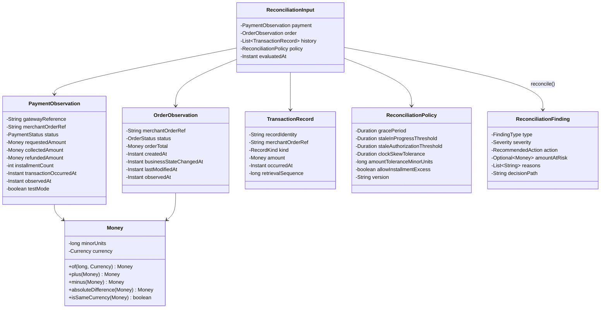

# Domain Model, Glossary and Status Vocabulary

## 1. The four concepts that are not interchangeable

Most reconciliation bugs come from conflating these. PayGuard keeps them separate everywhere, in code, in the
database and in customer-facing wording.

| Concept | Question it answers | Owner of the truth | Observable by PayGuard |
|---|---|---|---|
| **Payment success** | Did the gateway authorise and capture money from the cardholder? | Payment gateway | Yes, by query API |
| **Order fulfilment** | Does the shop consider this order paid and ready to ship? | E-commerce platform | Yes, by orders API |
| **Settlement** | Has the money, minus deductions, reached the merchant's bank? | Gateway and acquiring bank | Partly — PayTR exposes `net_tutar` and `kesinti_tutari`, and dated statements |
| **Refund status** | Has money been returned to the cardholder, in whole or part? | Gateway, sometimes initiated in the shop | Yes, via PayTR `returns` and iyzico reporting refund results |

A successful payment does not imply a fulfilled order. A fulfilled order does not imply settlement. A refund
in the shop does not imply a refund at the gateway, and vice versa. **PayGuard's entire value is in the gaps
between these four.**

### 1b. One authoritative source for gateway state

| Source | What it answers | Status in the model |
|---|---|---|
| **`PaymentObservation.status`** — from the provider's query API (PayTR `/odeme/durum-sorgu`) | "What is the state of this payment **now**?" | **Authoritative.** The decision table reads this and nothing else |
| **`TransactionRecord` list** — rows of the gateway's own transaction history (PayTR `/rapor/islem-dokumu`) | "What transactions **happened** against this order?" | **Evidence only.** Used for duplicate-capture detection, `decisionPath` and presentation order. Never determines or adjusts status |
| **Webhook notification** (iyzico only, optional, signature-gated) | "Something just happened" | **A run trigger.** Does not enter the core at all |

These three were conflated in revision 0.2, where a type called `PaymentEvent` left open whether it meant a
webhook payload or a history row, and FR-06 said the last one "decides the gateway state" — contradicting the
query-first architecture. The rename to `TransactionRecord` makes the answer unmistakable: it is history, from
the history endpoint.

**Why the query API must be authoritative, not the history.** PayTR's history service returns **no status field
at all** (`provider-capabilities.md` §1.4). A model in which history determined state would be unimplementable
against the only endpoint that supplies history. The query API is the only source that answers the question the
decision table asks.

**When they disagree**, neither wins: `INSUFFICIENT_DATA` with reason
`gateway_history_contradicts_queried_state`. Two endpoints of one provider contradicting each other is
something PayGuard can report but not resolve, and reporting it is more useful than picking a side.

## 2. One status vocabulary, used everywhere

Provider vocabularies differ (`success`/`failed`, `SUCCESS`, `pending`/`on-hold`/`processing`). Adapters
translate into the canonical vocabulary below at the boundary. Nothing downstream of an adapter ever sees a
provider's own string.

### PaymentStatus (canonical, gateway side)

| Value | Meaning | Mapped from |
|---|---|---|
| `CAPTURED` | Money taken from the cardholder | PayTR `status=success`; iyzico `paymentStatus=SUCCESS` |
| `AUTHORIZED` | Held but not captured | iyzico pre-auth phase |
| `FAILED` | Attempted and declined | PayTR `status=failed`; iyzico failure |
| `REFUNDED` | Fully returned | PayTR `returns` summing to the captured amount |
| `PARTIALLY_REFUNDED` | Partly returned | PayTR `returns` summing to less |
| `IN_PROGRESS` | Gateway has not finalised | PayTR "Devam Ediyor" (no `OK` received) |
| `ABSENT` | No gateway record found for this reference | Query returned nothing |
| `UNKNOWN` | A provider value we do not recognise | Anything unmapped |

`UNKNOWN` is deliberate. An unrecognised provider status must never be silently treated as success or
failure; it produces an `INSUFFICIENT_DATA` finding and an operator alert. See INV-07.

### OrderStatus (canonical, shop side)

| Value | Meaning | Mapped from WooCommerce |
|---|---|---|
| `AWAITING_PAYMENT` | Created, unpaid | `pending` |
| `PAYMENT_UNCONFIRMED` | Stock reduced, payment not confirmed | `on-hold` |
| `PAID_UNFULFILLED` | Paid, not yet shipped | `processing` |
| `FULFILLED` | Paid and complete | `completed` |
| `CANCELLED` | Cancelled by admin, customer, or stock-hold expiry | `cancelled` |
| `REFUNDED` | Refunded in the shop | `refunded` |
| `FAILED` | Payment attempt failed | `failed` |
| `DRAFT` | Checkout started, not a real order yet | block-checkout draft |
| `ABSENT` | No order found for this reference | nothing returned |
| `UNKNOWN` | A shop status we do not recognise | anything unmapped, including plugin-defined custom statuses |

`OrderStatus.UNKNOWN` was missing in revision 0.1. WooCommerce order statuses are extensible and plugins
routinely add their own, so an unrecognised shop status is expected rather than exceptional. Without this value
an adapter would have had to guess, which INV-07 forbids. Adding it takes the decision grid from 8 × 9 to
**8 × 10 = 80** cells.

### FindingType (the reconciler's output)

Sixteen types. **Severity is a function of the type alone** (INV-08, revised in 0.3). `amountAtRisk` is
`Optional<Money>`: absent means not computable, present-and-zero means a computed zero exposure, and neither
changes severity. Revision 0.2 let a zero amount demote a HIGH finding, which was unsafe — see requirements
§4.4. The authoritative per-type table of severity, action and exposure is requirements §4.4; this table is the
plain-words summary.

| Value | Condition in plain words | Severity | Default action |
|---|---|---|---|
| `MATCHED` | Payment and order agree, amounts included | INFO | NONE |
| `WITHIN_GRACE_PERIOD` | They disagree, but too recently to call it a problem | INFO | OBSERVE |
| `AUTHORIZATION_PENDING` | Funds authorised, not yet captured, within the stale-authorisation threshold | INFO | OBSERVE |
| `IN_PROGRESS_PENDING` | Gateway has not finalised, within the stale-in-progress threshold | INFO | OBSERVE |
| `INSUFFICIENT_DATA` | Cannot decide — an unrecognised status, two records claiming one identity, or history contradicting the authoritative status | MEDIUM | MANUAL_INVESTIGATION |
| `STALE_AUTHORIZATION` | Authorised and never captured, past the threshold. **Funds are reserved on a customer's card** | MEDIUM | ALERT_MERCHANT |
| `STALE_IN_PROGRESS` | Gateway stuck in progress past the threshold — typically PayTR never received an `OK` | MEDIUM | ALERT_MERCHANT |
| `AMOUNT_MISMATCH` | Amounts disagree beyond tolerance: order total, over-collection without instalments, or under-collection | MEDIUM | ALERT_MERCHANT |
| `STATUS_CONFLICT` | Both sides claim states that cannot both hold | MEDIUM | MANUAL_INVESTIGATION |
| `PAYMENT_WITHOUT_ORDER` | Gateway captured money; no usable order exists. **Only detectable by the gateway-first sweep** | HIGH | MANUAL_INVESTIGATION |
| `ORDER_UNPAID_DESPITE_PAYMENT` | Gateway captured; order still awaiting payment | HIGH | ALERT_MERCHANT |
| `PAYMENT_AGAINST_CANCELLED_ORDER` | Gateway captured; the shop already cancelled the order and released its stock | HIGH | MANUAL_INVESTIGATION |
| `ORDER_PAID_WITHOUT_PAYMENT` | Shop says paid; gateway has no capture | HIGH | MANUAL_INVESTIGATION |
| `REFUND_DIVERGENCE` | Refund state disagrees, in **either** direction — `gateway_only`, `shop_only`, or `partial_vs_full`, recorded in `reasons` | HIGH | MANUAL_INVESTIGATION |
| `CURRENCY_MISMATCH` | Order and payment currencies differ, both being present | HIGH | MANUAL_INVESTIGATION |
| `DUPLICATE_PAYMENT` | Two distinct-identity capture **records** for one order. Undetectable with no history supplied, and said so in `decisionPath` | HIGH | MANUAL_INVESTIGATION |

Three distinctions are deliberate and each was a correction:

**`PAYMENT_AGAINST_CANCELLED_ORDER` is separate from `ORDER_UNPAID_DESPITE_PAYMENT`** because WooCommerce
auto-cancels unpaid orders when Hold Stock is on, so the remedy differs: one is "mark it paid and ship", the
other is "the stock went back, decide whether to refund or re-create".

**`REFUND_DIVERGENCE` replaced `REFUND_NOT_REFLECTED`**, which was defined in one direction only (gateway
refunded, shop not) and was then used for the opposite cell. The direction a merchant must act on differs
sharply: `shop_only` means the customer is owed money and has not received it.

**`AUTHORIZATION_PENDING`/`STALE_AUTHORIZATION` and `IN_PROGRESS_PENDING`/`STALE_IN_PROGRESS` are pairs**
because a single type cannot be both "this is the normal intermediate state" and "this is stuck". Revision 0.1
used `WITHIN_GRACE_PERIOD` as a permanent verdict for authorisations, which is incoherent: a status meaning
"too early to judge" cannot hold forever.

### RecommendedAction

`NONE`, `OBSERVE`, `ALERT_MERCHANT`, `MANUAL_INVESTIGATION`. There is deliberately no `AUTO_REPAIR` in the
MVP vocabulary. Adding one is a separate decision with its own safety requirements (ADR-013).

## 3. Core domain objects

`decisionPath` on the finding records which rule fired and why. It exists so that a finding can be explained
to a merchant and audited later, and so that a test can assert on the reasoning rather than only the verdict.

## 3b. Four time concepts, and which may be used

Revision 0.1 conflated two of these and the grace period was therefore restartable by polling. Revision 0.2
separated five; revision 0.3 removed the grace ceiling (FR-04.3) and with it `firstDetectedAt`, leaving four.

| Concept | Field | Means | May a rule read it? |
|---|---|---|---|
| **Transaction occurrence** | `PaymentObservation.transactionOccurredAt` | When the transaction happened at the gateway — PayTR's `payment_date` | **Yes** |
| **Business-state change** | `OrderObservation.businessStateChangedAt` | **In Scope A: the order's creation time, and nothing else** (BR-07b) | **Yes** |
| **Source observation** | `*.observedAt` | When PayGuard fetched the record | **No — provenance only** |
| **Evaluation** | `ReconciliationInput.evaluatedAt` | The instant being evaluated for, injected | **Yes** |

The rule in one line: **temporal decisions use domain time, never retrieval time.** A retrieval time says when
PayGuard looked, which is a fact about PayGuard and not about the merchant's money.

`OrderObservation.lastModifiedAt` is kept for watermarking and diagnostics and is explicitly **not** a
business-state time, because WooCommerce's `date_modified` advances on any edit — a note added by staff would
otherwise restart the window.

`TransactionRecord.retrievalSequence` is kept for audit and is read by no rule, because retrieval order is what
INV-09 exists to be independent of. Overlapping discovery windows (ADR-014) mean the same row is deliberately
retrieved more than once, so retrieval order carries no domain meaning at all.

## 4. Invariants

These are the properties the implementation must preserve. Each is testable and each maps to tests in
`testing-strategy.md`.

| ID | Invariant | Why |
|---|---|---|
| INV-01 | **For every *valid* `ReconciliationInput`, `reconcile` returns exactly one `FindingType`.** Malformed input lies outside the valid domain and raises a documented typed exception (FR-08) | No silent gaps; an unhandled combination is a bug, not an empty result. Revision 0.2 said "every input", which contradicted FR-08 — totality is over the valid domain, as it is for any partial function made total by validation |
| INV-02 | `reconcile` is **pure**: no clock, no I/O, no randomness; `evaluatedAt` is injected | Makes grace-period and staleness behaviour deterministically testable |
| INV-03 | `reconcile` never mutates its inputs | Lets callers reuse observations across policies |
| INV-04 | `Money` arithmetic across currencies throws; it never coerces | Silent currency coercion is a financial-loss class of bug |
| INV-05 | `Money` minor units are integers; no floating point anywhere in the money path | Rounding drift |
| INV-06 | **Adding or removing content-identical repetitions of a `recordIdentity` does not change the finding.** Conflicting same-identity records are *not* duplicates for this purpose: they deliberately produce `INSUFFICIENT_DATA` (FR-05.3) | Overlapping discovery windows re-retrieve rows by design, so repetition must be inert. Revision 0.2's broader wording — "deduplicating never changes the finding" — was false, because collapsing a *conflicting* group would have changed the verdict |
| INV-07 | An unrecognised provider status yields `INSUFFICIENT_DATA`, never a success or failure verdict | Fail visibly, not optimistically |
| INV-08 | **Severity is a pure function of `FindingType` alone.** No amount, absent, present or zero, influences it | Consistent prioritisation, and it removes the unsafe demotion of a serious finding whose exposure merely could not be computed |
| INV-09 | **Permutation invariance.** For any two input lists that are permutations of one another and contain the same multiset of `TransactionRecord`s, `reconcile` returns an identical finding including `decisionPath`. Guaranteed because the canonical sort key — `occurredAt`, tie-broken on `recordIdentity` — is derived entirely from set-intrinsic data | Retrieval order must not change outcomes, and overlapping discovery windows guarantee that order varies. Revision 0.1 tie-broke on retrieval sequence, which broke the very invariance it asserted |
| INV-10 | The core module has **no dependency** on any gateway, HTTP client, database or framework | Makes Scope A independently executable, and keeps the domain testable forever |
| INV-11 | **No rule reads a retrieval time (`observedAt`) or a retrieval order (`retrievalSequence`).** Both exist for provenance and audit only | These are facts about PayGuard's own behaviour. A verdict that depends on them changes when nothing about the merchant's money has changed — the grace-period defect and the tie-break defect were both instances |
| INV-12 | **For a fixed pair of observations, `discrepancyAge` is strictly increasing in `evaluatedAt`.** Therefore a discrepancy leaves the grace window exactly once and never returns to it | Makes "polling cannot suppress a discrepancy" provable *inside the module*. Revision 0.2 also asserted a ceiling clause whose truth depended on the caller maintaining episode identity — not a property of this module, so it was removed with the ceiling (FR-04.3) |
| INV-13 | **`PaymentObservation.status` is the sole determinant of gateway state in the decision table.** Transaction history can only produce `DUPLICATE_PAYMENT`, contribute to `INSUFFICIENT_DATA` on contradiction, or populate evidence — it can never change which table cell is selected | One source of truth. Revision 0.2's FR-06 let history override a queried status, contradicting ADR-004 |

INV-10 is the load-bearing one for the project: it is what lets the same code be the university deliverable and
the product's decision engine.

INV-11, INV-12 and INV-13 are load-bearing for correctness, and all three exist because review found the
architecture violating them. The first two share a shape worth naming: **a verdict must be a function of the
merchant's world, not of PayGuard's own operational history.** Retrieval times, retrieval order and poll
frequency are the latter. INV-13 adds the companion rule: **where two sources could answer the same question,
exactly one of them answers it**, and a disagreement is reported rather than resolved by precedence.

## 5. Glossary

| Term | Definition |
|---|---|
| **Authorisation** | The card issuer reserves funds; money has not moved |
| **Capture** | The reserved funds are actually taken |
| **Callback / notification** | A server-to-server POST from the gateway announcing a result. PayTR calls this the Notification URL; iyzico calls it a webhook |
| **`merchant_oid`** | PayTR's name for the merchant's own order reference, unique per order |
| **`conversationId`** | iyzico's correlation identifier matching a request to its response |
| **`paymentId`** | iyzico's identifier for a payment, which the merchant is expected to store |
| **Minor units** | The smallest indivisible unit of a currency — kuruş for lira. PayTR transmits amounts multiplied by 100 |
| **Instalment (`taksit`)** | Splitting a card payment across months. The collected total can exceed the requested amount |
| **Deduction (`kesinti`)** | Gateway commission and fees withheld before settlement |
| **Net amount (`net_tutar`)** | What remains after deductions |
| **Settlement** | The transfer of collected funds, net of deductions, to the merchant's bank |
| **Chargeback / ters ibraz** | A cardholder-initiated reversal through the card scheme. **Out of scope for the MVP** |
| **Grace period** | How long a disagreement is tolerated before it counts as a finding, because both sides are eventually consistent |
| **Reconciliation run** | One scheduled pass over a store's candidate orders and payments |
| **Finding** | One identified discrepancy, with a type, severity and recommended action |
| **Idempotency** | Processing the same input twice has the same effect as processing it once |
| **Eventual consistency** | The two systems converge given time; a disagreement observed now may be legitimate |
| **Read-only mode** | PayGuard holds credentials that let it query but it never calls a mutating provider endpoint |

## 6. The eventual-consistency problem, stated plainly

The gateway and the shop are two independent systems updated by separate processes. At any instant they are
allowed to disagree. iyzico's first webhook arrives 10 to 15 seconds after the payment attempt, and PayTR
retries a minute later on failure. So a disagreement observed one second after checkout means nothing.

This is why `gracePeriod` is a first-class policy parameter and not a magic number buried in a condition. It
is also why `WITHIN_GRACE_PERIOD` is a distinct finding type rather than the absence of a finding: PayGuard
needs to record that it looked, found a disagreement, and chose to wait. Without that record, a run that
produced nothing is indistinguishable from a run that never happened.
