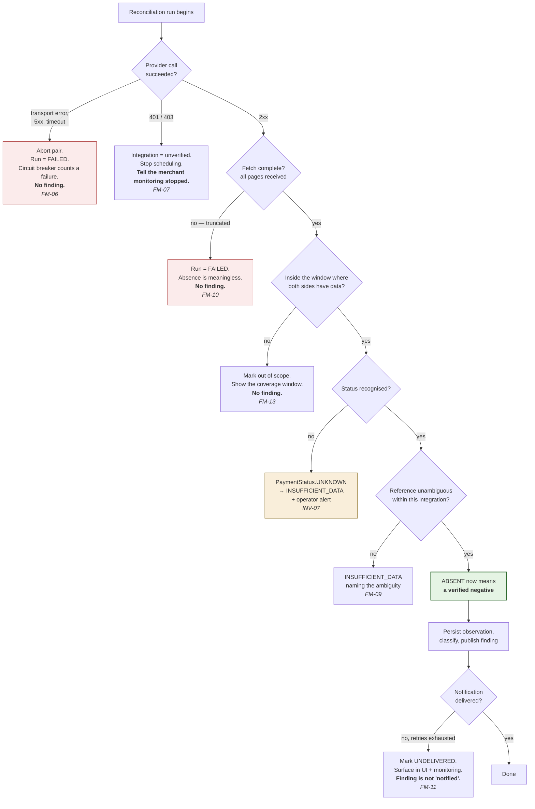

# Error, Fault and Failure Engineering

## 1. The taxonomy, and why the distinction is not pedantry

| Term | Definition used here | Example in PayGuard | Who must act |
|---|---|---|---|
| **Error** | A mistake in code or configuration — a latent defect | A rule compares the collected amount instead of the requested amount | Developer |
| **Fault** | An error activated at runtime, producing an incorrect internal state | That rule computes a mismatch for a legitimate instalment payment | Developer, once detected |
| **Failure** | Observable deviation from required behaviour | The merchant is told 1,250 TRY is missing when nothing is wrong | Operator, then developer |
| **Invalid input** | Data outside the contract | `occurredAt` after `evaluatedAt`; a negative amount | Reject with a typed error naming the field |
| **Domain inconsistency** | Two valid observations that cannot both be true | Shop says paid, gateway has no capture | **Not an error — this is the product's output** |
| **Infrastructure failure** | PayGuard's own environment fails | Database unreachable, process killed | Retry, recover, alert |
| **External provider failure** | A provider is unavailable or wrong | Gateway returns 503, or an unrecognised status value | Degrade visibly, never guess |

The fourth and fifth rows are the ones that matter most. **A domain inconsistency is a finding, not a bug.**
PayGuard's whole purpose is to detect states that should not coexist. A system that treated them as errors
would log and discard its own product. Conversely, invalid *input* must never become a finding — a corrupted
payload must not be reported to a merchant as a discrepancy in their money.

The line between them: a domain inconsistency is two well-formed observations that disagree. An invalid input
is an observation that is not well-formed at all.

## 2. Failure-mode analysis

Fifteen scenarios. For each: trigger, risk, detection, expected behaviour, recovery, evidence, tests.

### FM-01 — The same transaction record retrieved more than once

- **Trigger:** **By design.** Gateway-first discovery walks the Transaction Detail service in windows of at most three days, and consecutive windows deliberately overlap by a configured margin so no transaction can fall between them (ADR-014, FM-14). Every row in an overlap is therefore retrieved twice. A re-run after a failed run re-reads the same window again.
- **Provider background:** PayTR also retries its *callback* after a minute when it receives no `OK`, and documents that the same notification can arrive more than once ([docs](https://dev.paytr.com/en/iframe-api/iframe-api-2-adim)). That retry lands on the **merchant's own** Notification URL, not PayGuard's — under the query-first architecture PayGuard does not receive it, and a callback is never a record entering the core (ADR-004, ADR-016). It is listed here as domain background only, because it is the reason the merchant's own order state can lag.
- **Risk:** A re-retrieved row is counted as a second capture, producing a false `DUPLICATE_PAYMENT` and an alarming message about money that was never double-charged.
- **Detection:** The row's `recordIdentity` — a provider row identifier where one exists, otherwise a content digest over the row's significant fields, computed by the adapter (FR-05.1, ADR-015) — is already present in the working set.
- **Expected behaviour:** Content-identical repetitions collapse to one record (FR-05.2). Retrieval count is kept for audit. The verdict is identical to the one computed without the repeats — INV-06, stated precisely as *adding or removing content-identical repetitions of a `recordIdentity` does not change the finding*.
- **Recovery:** None needed — the design makes repetition inert, which is what lets the discovery walk overlap freely.
- **Evidence:** Retrieval count per `recordIdentity` on the observation record.
- **Tests:** Unit — the same row ×1, ×2, ×5 give one verdict. Property — `RepetitionInvariancePropertyTest` over generated histories. Conflicting same-identity rows are **excluded** from this property and covered by `ConflictingIdentityTest`, because they are not duplicates and must yield `INSUFFICIENT_DATA` (FR-05.3).

### FM-02 — Late callback delivery, order already auto-cancelled

- **Trigger:** The merchant's shop never acknowledged, the gateway retried, and meanwhile WooCommerce's Hold Stock setting auto-cancelled the pending order and released its stock ([docs](https://woocommerce.com/document/managing-orders/order-statuses/)).
- **Risk:** Reported as `ORDER_UNPAID_DESPITE_PAYMENT`, the merchant marks it paid and ships goods whose stock was already returned to inventory and possibly sold again.
- **Expected behaviour:** `PAYMENT_AGAINST_CANCELLED_ORDER`, HIGH, `MANUAL_INVESTIGATION` — a distinct finding type precisely because the remedy differs.
- **Recovery:** Human decision: refund, or re-create the order and ship.
- **Evidence:** Both observations with their times, and the decision path showing the cancelled order status.
- **Tests:** Decision-table cell (`CAPTURED`, `CANCELLED`); a scenario test with a capture timestamped before the cancellation.

### FM-03 — Transaction history contradicting the authoritative status

- **Trigger:** The gateway's two endpoints disagree. The clearest case is a Status Inquiry returning `FAILED` or no record, while the Transaction Detail service lists one or more capture rows for the same `siparis_no`. Provider-side data lag, a partial write, or a genuine reversal can each produce it.
- **Risk:** Resolving the disagreement by rule. Letting the history win would reintroduce the event-replay model the query-first architecture rejects, on data PayGuard cannot prove is complete. Letting the status win silently would discard evidence of a real problem. Either way a merchant receives a confident verdict derived from contradictory evidence.
- **Detection:** Gate 2 of the rule chain compares the authoritative status against the deduplicated record set (FR-06).
- **Expected behaviour:** **`PaymentObservation.status`, from the query API, selects the gateway state — always** (INV-13). Transaction history is evidence only, with three permitted uses: detecting two distinct capture records, populating `decisionPath`, and giving a deterministic presentation order. **History never overrides the queried status.** Where the two are mutually impossible, **neither wins**: the result is `INSUFFICIENT_DATA`, reason `gateway_history_contradicts_queried_state`, recording both sides. PayGuard reports that two endpoints of one provider disagree, which is what it actually knows.
- **Recovery:** Operator investigation. A re-query on a later run may resolve a transient lag by itself, and the finding closes automatically if the sides then agree.
- **Evidence:** The authoritative status, the full canonically ordered record set, and both sides of the contradiction in `decisionPath`.
- **Tests:** `AuthoritativeStateTest` — a `FAILED` status with a capture record yields `INSUFFICIENT_DATA` and never `CAPTURED`; a `CAPTURED` status with an empty history still yields the ordinary table verdict; history that is richer than the status without contradicting it (a refund row against a `PARTIALLY_REFUNDED` status) does not trigger the gate. Property — for a fixed authoritative status, varying the history across every non-contradictory shape never changes the selected table cell (INV-13).

### FM-04 — Reconciliation executed twice

- **Trigger:** A double trigger from the scheduler, a merchant clicking "run now" twice, or a retry after an ambiguous timeout.
- **Risk:** Two findings for one problem, so two notifications, which cannot be recalled.
- **Detection:** `RECONCILIATION_RUN.id` is a scheduler-supplied idempotency key; `finding_key` is unique per open finding (ADR-006).
- **Expected behaviour:** One run record, one finding, one notification. The second attempt is a no-op returning the first run's result.
- **Recovery:** None needed.
- **Evidence:** Run record with its idempotency key; findings carrying a single `run_id`.
- **Tests:** Integration — trigger twice with the same key, assert one run and one finding; trigger with different keys concurrently, assert the lock serialises them.

### FM-05 — Processing interrupted mid-run

- **Trigger:** Process killed, deployment during a run, out-of-memory.
- **Risk:** Observations persisted but findings not, leaving an inconsistent picture; or the watermark advanced past unreconciled orders, which would skip them permanently.
- **Detection:** Run left in `STARTED` beyond a timeout.
- **Expected behaviour:** Watermark untouched (ADR-009). The stale `STARTED` run is marked `FAILED` by a sweeper. No partial findings are visible, because findings are persisted in one transaction (NFR-06). The next run re-reads the same window and re-ingestion is a no-op.
- **Recovery:** Automatic on the next scheduled run.
- **Evidence:** `RECONCILIATION_RUN` with `state=FAILED`, `failure_reason=timeout`.
- **Tests:** Kill the process mid-run in a test harness; assert no published findings, watermark unchanged, and that a re-run produces the correct finding set exactly once.

### FM-06 — Temporary gateway unavailability

- **Trigger:** Provider 5xx, timeout, DNS failure, or maintenance.
- **Risk:** Treating "no response" as "no payment", which would manufacture `ORDER_PAID_WITHOUT_PAYMENT` findings across a whole store — a mass false alarm, the single worst output this system can produce.
- **Detection:** Transport error or non-2xx from the adapter.
- **Expected behaviour:** **A transport failure is never a `PaymentStatus`.** `ABSENT` means "the provider answered and had no record". A failed call aborts the pair's reconciliation, the run is marked `FAILED` with a reason, and a per-integration circuit breaker opens after repeated failures. No finding is produced from a failed call.
- **Recovery:** Retry with exponential backoff and jitter; the watermark holds; the merchant is told the integration is unhealthy if failures persist.
- **Evidence:** Run failure reason, `provider_calls` count, circuit-breaker state transitions.
- **Tests:** Adapter test with a stubbed 503 asserting the exception type, not an `ABSENT` observation; integration test asserting zero findings from a failed run; a circuit-breaker test.

> This is the most important row in the table. The distinction between `ABSENT` (a verified negative) and a
> failed call (no information) is the difference between a useful product and one that cries wolf at scale.

### FM-07 — Authentication failure against a provider

- **Trigger:** Rotated or revoked credentials, a wrong `merchant_salt`, an expired iyzico key, a WooCommerce key deleted by the merchant.
- **Risk:** Silent, permanent blindness for that store — the most dangerous failure for a monitoring product, because nothing appears wrong.
- **Detection:** 401 or 403 from the provider, or a PayTR token rejection.
- **Expected behaviour:** Mark the integration `unverified`, stop scheduling runs against it, notify the merchant that monitoring has **stopped**, and keep saying so until it is fixed. Never degrade quietly.
- **Recovery:** Merchant re-enters credentials; a verification call must succeed before runs resume.
- **Evidence:** Audit entry for the auth failure; integration state change; notification record.
- **Tests:** Adapter test for 401 handling; integration test asserting the integration is disabled and a notification is queued.

### FM-08 — Database unavailable

- **Trigger:** Managed database failover, connection-pool exhaustion, network partition.
- **Risk:** Findings computed and lost; or observations written without their findings.
- **Expected behaviour:** The run fails before publishing anything. Observation ingestion and finding persistence for a pair happen in one transaction, so the failure is atomic. The watermark does not advance.
- **Recovery:** Next scheduled run; idempotent ingestion means no duplicates.
- **Evidence:** Run marked `FAILED`; database error in structured logs.
- **Tests:** Integration test with the database stopped mid-run; assert atomicity and watermark stability.

### FM-09 — Incorrect or unmatched transaction identifiers

- **Trigger:** A merchant uses non-unique `merchant_oid` values across stores, changes their order-numbering scheme, or runs two shops through one PayTR account. PayTR's duplicate guidance keys on `merchant_oid`, which is unique only within one merchant.
- **Risk:** Cross-matching one store's payment to another store's order — a false finding built on someone else's data.
- **Detection:** Natural keys are scoped by `integration_id`, so a match can never cross integrations. A reference appearing with conflicting order data is flagged.
- **Expected behaviour:** `INSUFFICIENT_DATA` with a reason naming the ambiguity. Never a money finding from an ambiguous match.
- **Recovery:** Operator investigates; the merchant may need separate integrations per store.
- **Evidence:** The ambiguous reference and both candidate records.
- **Tests:** Two integrations sharing a `merchant_oid` value; assert no cross-match and an `INSUFFICIENT_DATA` outcome.

### FM-10 — Partial data ingestion

- **Trigger:** WooCommerce pagination truncated by a timeout mid-way (pages are capped at 100 orders, so a large window is many calls).
- **Risk:** Reconciling a partial order set and concluding that absent orders do not exist, producing false `PAYMENT_WITHOUT_ORDER` findings.
- **Detection:** Page count and total compared against the response's pagination headers; the run tracks completeness explicitly.
- **Expected behaviour:** An incomplete fetch fails the run. **Absence is only meaningful when the fetch was complete** — the same principle as FM-06.
- **Recovery:** Re-run; the watermark held.
- **Evidence:** Expected versus received page count in the run record.
- **Tests:** Stub a truncated pagination sequence; assert the run fails and no findings are published.

### FM-11 — Alert delivery failure

- **Trigger:** E-mail provider down, rejected recipient, rate limit.
- **Risk:** A HIGH finding exists in the database and the merchant never hears about it. For a monitoring product this is equivalent to not having found it.
- **Detection:** Delivery attempt recorded with its outcome.
- **Expected behaviour:** Retry with backoff. After exhausting retries, mark the notification `UNDELIVERED` and surface it in the UI and in operational monitoring. A finding is never marked notified unless a delivery succeeded.
- **Recovery:** Manual resend; a second channel is a future addition.
- **Evidence:** `NOTIFICATION` rows with attempt history.
- **Tests:** Stubbed failing provider; assert retries, the `UNDELIVERED` state, and that the finding is not marked notified.

### FM-12 — Concurrent reconciliation attempts on one store

- **Trigger:** A scheduled run overlapping a manual run, or a scheduler firing before the previous run finished.
- **Risk:** Both runs advance the watermark, one overwriting the other's progress; or duplicate findings race on the same `finding_key`.
- **Detection:** A per-store advisory lock held for the run's duration.
- **Expected behaviour:** The second attempt does not run; it returns the in-progress run's identifier. If the lock is lost (expiry during a long run), uniqueness constraints still prevent duplicate findings — the lock is an optimisation, the constraints are the guarantee (ADR-006).
- **Recovery:** None needed.
- **Evidence:** Lock acquisition and release in the run record.
- **Tests:** Two concurrent triggers; assert one run executes. A test with the lock deliberately released mid-run, asserting constraints still yield one finding.

### FM-13 — Incomplete historical payment data on first connection

- **Trigger:** A newly connected store has months of past orders. The Transaction Detail service retrieves at most a 3-day window per call ([docs](https://dev.paytr.com/en/islem-dokumu)), and how far back its history extends is unknown (UNK-08), so the gateway may not expose history as far back as the shop's orders go.
- **Risk:** Every old order with no retrievable payment record becomes a false `ORDER_PAID_WITHOUT_PAYMENT`. On a first connection this could be thousands of findings — the fastest way to lose a new customer.
- **Detection:** The integration records the earliest date for which gateway data is available.
- **Expected behaviour:** Reconciliation is bounded to the window where **both** sides have data. The backfill walks 3-day windows backwards until the service reports no transactions, which establishes the coverage floor empirically. Orders older than that floor are marked out of scope and excluded, not reported. The merchant is told what period is covered.
- **Recovery:** None; this is a design constraint, not a fault.
- **Evidence:** Per-integration coverage window, shown in the UI.
- **Tests:** Connect a store with orders predating gateway availability; assert zero findings for the uncovered period and a visible coverage window.

## 2b. The decision that most failure scenarios reduce to

Eight of the fifteen scenarios (FM-06, FM-07, FM-08, FM-10, FM-13, FM-14, FM-15 and in part FM-09) turn on one question:
**did we actually learn something, or did we merely fail to learn it?** This is the flow every ingestion path
follows before a verdict is allowed.

The green node is the only point at which `ABSENT` carries information. Every red and amber path exits without
producing a merchant-facing finding, which is what stops a provider outage from manufacturing a store-wide
false alarm.

### FM-14 — Partial gateway discovery implying an absent order

- **Trigger:** Sweep A's walk over 3-day windows is interrupted — a provider error mid-walk, a rate limit, a process restart — so some windows were never retrieved.
- **Risk:** This is FM-10's failure arriving by a new route, and it is worse in this direction. A transaction PayGuard never retrieved is indistinguishable from one that does not exist. Worse, the shop-side lookup would be asked about order references that were never discovered, so the **absence of a finding** would be mistaken for agreement — a silent false negative rather than a noisy false positive.
- **Detection:** Per-window completion is recorded on the run. The walk's expected window set is derived from the watermark and compared against the completed set.
- **Expected behaviour:** An `OrderObservation` with status `ABSENT` is produced **only** for a window recorded complete (BR-11). An incomplete walk fails the run, advances no watermark, and publishes nothing. Windows overlap by a configured margin so a transaction landing on a boundary cannot fall between two walks.
- **Recovery:** Automatic on the next run; re-walking is harmless because ingestion is idempotent by natural key (ADR-006).
- **Evidence:** Expected versus completed window sets in the run record; `provider_calls` count.
- **Tests:** Failure-injection test that errors on window 3 of 5; assert the run fails, both watermarks hold, no `ABSENT` observation is written for any window, and no finding is published. Then re-run and assert the correct finding set appears exactly once.

### FM-15 — Discovery service omits the transaction states we need

- **Trigger:** The Transaction Detail service has **no per-transaction status field**, and whether it lists non-completed transactions at all is unverified (UNK-10).
- **Risk:** Treating presence in the report as proof of capture. A transaction appearing with `islem_tipi=S` would then stand in for `CAPTURED`, which is an inference the service does not support — the same class of mistake as reading a failed call as `ABSENT` (FM-06).
- **Detection:** Not detectable at runtime; this is a design constraint to respect rather than a fault to catch.
- **Expected behaviour:** Discovery never assigns a canonical `PaymentStatus`. Every candidate is confirmed by a Status Inquiry call, which returns a status, a precise `payment_date` and the `returns` block. A candidate that cannot be confirmed produces no finding.
- **Recovery:** None needed; the two-stage design is the mitigation.
- **Evidence:** Each `PaymentObservation` records which endpoint produced it, so a finding built on an unconfirmed discovery record would be visible in the data.
- **Tests:** Contract test asserting the discovery adapter returns candidates without a `PaymentStatus`; engine test asserting that an unconfirmed candidate yields `INSUFFICIENT_DATA` rather than a status-based verdict.

## 3. Cross-cutting principles these scenarios produce

1. **No information is not negative information.** FM-06, FM-10, FM-14 and FM-15 all reduce to this. `ABSENT` requires a successful, complete query — and in the discovery direction, a *completed window walk* (BR-11). A failure yields no verdict, and presence in a report that carries no status field is not a status.
2. **Silence is a failure.** FM-07 and FM-11: an integration that stopped working and a notification that never arrived must both be loud. A monitoring product whose own failures are invisible has the defect it is selling a cure for.
3. **Idempotent effects, not exactly-once delivery.** FM-01, FM-04 and FM-12 are all handled by natural keys rather than by trying to guarantee single delivery, which is not achievable across HTTP.
4. **Bias toward re-processing over skipping.** FM-05 and FM-08: re-processing is free, skipping is unrecoverable.
5. **Degrade visibly.** Every scenario either produces a correct finding or produces no finding plus an operational signal. None produces a guess.

## 4. What must never happen

| Must never | Enforced by |
|---|---|
| A provider call failure becomes a merchant-facing finding | FM-06; adapters throw rather than returning `ABSENT` |
| An incomplete fetch produces an absence finding | FM-10; run completeness is explicit |
| An incomplete discovery walk produces an absent *order* | FM-14; BR-11 requires per-window completion |
| Presence in the discovery report is read as a payment status | FM-15; discovery assigns no `PaymentStatus`, confirmation does |
| A retrieval time or a retrieval order changes a verdict | INV-11; no rule may read `observedAt` or `retrievalSequence` |
| Transaction history overrides the queried gateway state | INV-13; the table reads `PaymentObservation.status` alone (ADR-016) |
| A serious finding is demoted because its exposure could not be computed | INV-08; severity depends on `FindingType` alone, and `amountAtRisk` is optional |
| Polling suppresses a discrepancy indefinitely | INV-12; grace uses fixed domain time in Scope A, so discrepancy age increases with `evaluatedAt` and polling cannot restart the window |
| The watermark advances past unreconciled orders | ADR-009; advance only on success |
| A merchant is notified twice for one problem | ADR-006; `finding_key` uniqueness |
| An unrecognised provider status is read as success or failure | INV-07; `UNKNOWN` → `INSUFFICIENT_DATA` |
| Monitoring stops without the merchant knowing | FM-07; integration disabled plus notification |
| PayGuard changes anything at a provider | ADR-013; endpoint allowlist |

## 5. Retention

| Data | Retention | Reason |
|---|---|---|
| `raw_payload` on observations | Shortest; configurable per store | Contains customer identifiers and a masked card number (NFR-14) |
| Normalised observations | Longer; needed to explain historical findings | NFR-15 |
| Findings and audit entries | Longest; the record of what was reported and done | Disputes arise months later |
| Notification bodies | Short | Reconstructible from the finding |
| Credentials | Until the integration is removed, then deleted from the secret store | Nothing is gained by keeping them |
