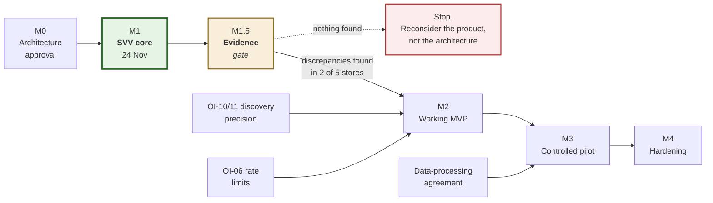

# Implementation Roadmap

Five milestones, with one addition to the ordering given in the brief and a reason for it.

**The change.** The brief places the controlled pilot at Milestone 3, after the MVP is built, so demand is
tested with a finished product. You have said you want product-market fit before writing code. Those conflict.
This roadmap inserts **Milestone 1.5 — Evidence** between the academic core and the MVP build: a few days of
throwaway scripts against real stores that answer the central commercial assumption and the blocking technical
unknown for a fraction of an MVP's cost. Milestone 2 does not start unless 1.5 passes.

No completion guarantees are given. Milestone 1 has a fixed external deadline; everything after it has
dependencies and gates rather than dates.

---

## Milestone 0 — Architecture approval

**Goal:** agree the requirements, business rules, module boundaries and acceptance criteria before code.

**Deliverables:** this package, reviewed.

**Dependencies:** none.

**Acceptance:** the 80-cell decision table is agreed; the twelve invariants are agreed; the three blocking issues
(OI-01, OI-02, OI-06) are either closed or consciously accepted as open; the eight Scope A requirements are
confirmed as the whole of the 24 November deliverable.

**Key risks:** spending review time on Scope B and C while the deadline for Scope A approaches. The review
should timebox to Scope A.

**Out of scope:** any code, any repository scaffold, any dependency.

---

## Milestone 1 — SVV academic core

**Goal:** a submitted assignment. Nothing else counts in this milestone.

**Window:** now until **24 November 2026**. Two days.

**Deliverables:**

1. A Maven project with one module, `payguard-core`, no runtime dependencies.
2. The model, policy, engine, rules, result and error packages as laid out in SAD §5.4.
3. The JUnit 5 suite from `testing-strategy.md` §8, including the two property tests that encode the review's corrections (`GraceSuppressionTest`, `OrderIndependencePropertyTest`).
3b. `ReconciliationDemo.main` — the runnable entry point (SAD §5.5), with zero runtime dependencies preserved.
4. JaCoCo configured, with real measured figures.
5. A defect log with genuine entries.
6. A report of at most seven pages, in Ranim's own words, filed as
   `STUDENTNUMBER_FIRSTNAME_LASTNAME.pdf`, submitted through Blackboard.

**Dependencies:** Milestone 0. **The instructor's approval of the proposal**, which the assignment requires
before implementation — with two days left this is the first thing to secure, today.

**Acceptance:** all 80 decision-table cases pass; all twelve invariants have a passing test; the negative suite
passes; `ReconciliationDemo` runs and prints its scenarios; coverage measured and its limitations discussed; at
least three references read and cited; the filename is exactly right, because the wrong name costs ten points.

**Suggested order, given the time:** `Money` and the enums first (ten values in `OrderStatus`, not nine),
because everything depends on them; then `ReconciliationInput` with its five time fields and the engine
skeleton returning `MATCHED`; then the decision-table test transcribed from requirements §4.2 with all 80 cases
failing; then rules one at a time until it passes, in priority order so the gates come first; then the boundary
tests; then negatives; then the three property tests; then `ReconciliationDemo`; then coverage and the report.

Transcribing the decision table before writing any rule is the step that makes the specification drive the
code. It also means the suite fails comprehensively on day one, which feels wrong and is right.

**Key risks:**

- **Scope creep into the MVP.** The highest risk by far. No adapter, no database, no HTTP, no persistence.
- **Report time underestimated.** The report carries most of the marks. Reserve at least a third of the
  remaining time for it.
- Proposal approval not obtained, which would make the whole submission inadmissible.

**Explicitly out of scope:** every provider adapter; both discovery sweeps (the core classifies pairs, it does
not fetch them); persistence; HTTP; notifications; the UI; multi-tenancy; authentication; deployment;
`PAYMENT_AGAINST_CANCELLED_ORDER`'s operational workflow (the finding type exists, the workflow does not);
refund **amount** arithmetic (FR-07 reduced — `testing-strategy.md` §13); mutation testing unless time permits.

---

## Milestone 1.5 — Evidence

**Goal:** find out whether the problem is real, and whether the product's headline capability is technically
possible, before building anything.

**Window:** after submission. A few days of work, plus waiting time for provider answers.

**Deliverables:**

1. **Provider sandbox findings.** OI-01 is already closed by documentation, so the session targets the four
   precision unknowns, and `dummy=1` on the Transaction Detail service means a first pass needs no real
   transaction: UNK-09 (does `islem_tarihi` ever carry a time?), UNK-10 (do non-completed transactions appear
   at all?), UNK-08 (how far back does history extend?), UNK-11 (the per-item shape of `returns`), and UNK-05
   (is a read-only credential scope available?). Throwaway scripts, not product code.
2. **Rate-limit answers** from both providers (OI-06), by email if not documented.
3. **A past-data audit.** With permission, compare 90 days of gateway records against shop orders for five of
   your agency's stores, using throwaway scripts — not the MVP. Count real discrepancies by type and dated
   amount.
4. **Five interviews** with store owners or developers, asking when a paid order last failed to arrive and
   what it cost, before describing the product.
5. A short written answer to: does this happen often enough that someone would pay?

**Dependencies:** Milestone 1 submitted. Merchant permission for the audit.

**Acceptance — this is the gate for Milestone 2:**

- Unexplained discrepancies found in **at least two of five** stores, with amounts attached; **and**
- UNK-09 and UNK-10 answered, so the call-volume arithmetic for two sweeps is known; **and**
- at least two of five interviewees describe a specific past incident unprompted.

The audit itself should run **both** directions, because the shop-first direction is the one revision 0.1
could do and the gateway-first direction is the one that finds orphan payments. If the audit only compares
orders against payments, it measures the smaller half of the problem and could pass the gate while missing the
product's main claim.

**If it fails:** do not build the MVP. The Round 2 research named two alternatives — Backup Proof and
KesintiRadar — and the core library is reusable for neither, but three days of scripts is a far cheaper way to
learn this than three months of building.

**Key risks:** finding nothing and talking yourself into building anyway. Write the pass threshold down before
running the audit, which is what the acceptance criteria above are for.

**Out of scope:** any production code; any infrastructure; any design work on the MVP.

---

## Milestone 2 — Working product MVP

**Goal:** one real store reconciling end to end, one gateway, one platform, report-only.

**Dependencies:** Milestone 1.5 passed. OI-01 and OI-06 answered.

**Deliverables:** the PayTR adapter (both the Transaction Detail discovery walk and Status Inquiry
confirmation) and the WooCommerce adapter; **both reconciliation sweeps** with per-window completion tracking
(BR-11); observation persistence with natural keys; the scheduler with missed-run detection; findings with
workflow states; **FR-33's discrepancy-episode tracking if and only if the adapter supplies a moving
`businessStateChangedAt`** (FR-04.3); e-mail digests; a minimal UI
showing findings with their evidence and decision path; store connection with credential storage; the audit
log.

**Acceptance:** a real store connects and reconciles on a schedule; a deliberately created discrepancy is found
in **both** directions — an orphan payment via sweep A and an order-paid-without-capture via sweep B; the
release-gate tests pass (cross-tenant isolation, signature tampering, log redaction, provider-outage injection,
truncated-pagination injection, **interrupted discovery walk** per FM-14, killed-mid-run recovery); no mutating
provider endpoint exists in the codebase; a restore from backup has been rehearsed.

**Key risks:** provider response shapes differing from the documentation, which the sandbox work in 1.5 should
have surfaced; underestimating the adapter work, since amount and status mapping and the digest-based event
identity are where the subtle bugs live; call volume from two sweeps exceeding rate limits; building the agency
view before anyone has asked for it (FR-30 is unvalidated).

**Out of scope:** the second gateway; the second platform; any corrective action; the agency multi-store view;
organisations and roles beyond one user per store; row-level security; a public API; mobile.

---

## Milestone 3 — Controlled pilot

**Goal:** a small number of real merchants using it, and measurement of whether the findings are true and
useful.

**Dependencies:** Milestone 2. A KVKK data-processing agreement, which is a prerequisite to taking money, not
to building.

**Deliverables:** three to five merchants onboarded; measured false-positive rate per finding type; tuned
grace period and stale threshold from real data (OI-05); a decision on OI-04 (whether a stale authorisation
needs its own finding type); the first pricing conversation.

**Acceptance:** at least one merchant pays. Measured false-positive rate low enough that merchants still read
the alerts — the number to beat should be set by what they tell you, not asserted here.

**Key risks:** false positives from a mis-tuned grace period teaching merchants to ignore the alerts, which is
unrecoverable trust damage; first-connection noise if FM-13's coverage-window handling is wrong, which could
produce thousands of findings on day one.

**Out of scope:** scaling work; automation; enterprise features; a second market.

---

## Milestone 4 — Commercial hardening

**Goal:** make it safe and operable at more than pilot scale, based on evidence rather than anticipation.

**Dependencies:** Milestone 3, with pilot data in hand.

**Deliverables, in the order the pilot's evidence justifies:** row-level security (OI-07, the first security
investment); per-integration circuit breakers tuned to measured provider behaviour; a second gateway if
customers ask; availability measurement before any availability promise (NFR-09); a penetration test;
retention automation; an operational dashboard.

**Acceptance:** each item traceable to something the pilot revealed. An item that cannot be traced to evidence
should wait.

**Key risks:** hardening against imagined problems instead of measured ones; adding corrective action under
customer pressure before ADR-013's five reconsideration conditions are all met.

**Out of scope:** anything that ADR-013 forbids until all five conditions hold.

---

## Dependency view

The dotted line is the one that matters. An architecture document that cannot describe the path where the
product turns out to be unwanted is selling, not engineering.
