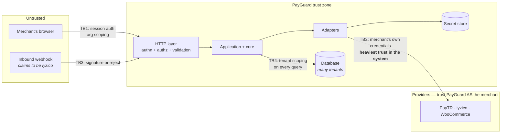

# Security and Privacy Architecture

## 1. What PayGuard is, from an attacker's point of view

PayGuard holds, for many merchants at once, credentials that let it query a payment gateway **as that
merchant**. At PayTR those same credentials (`merchant_key`, `merchant_salt`) also authorise the refund
endpoint, and no read-only scope is documented (UNK-05). PayGuard also holds a database of payment records
across multiple businesses.

So PayGuard is a credential aggregator for Turkish e-commerce payments. That is a more attractive target than
"a reconciliation dashboard" suggests, and the architecture should be judged on that basis rather than on the
modesty of its feature set.

This document states controls proportionate to the MVP. It does not claim legal compliance.

## 2. Trust boundaries

| Boundary | Between | Control |
|---|---|---|
| **TB1** | Browser and PayGuard | Session authentication; every request authorised against the caller's organisation |
| **TB2** | PayGuard and providers | PayGuard presents the merchant's credentials and is trusted as the merchant. Mitigated only by ADR-013's endpoint allowlist, which is self-imposed |
| **TB3** | Inbound webhook and PayGuard | `X-IYZ-SIGNATURE-V3` verified, or rejected and recorded. Payload is a trigger, never truth (ADR-004) |
| **TB4** | Tenant and tenant | Repository-level scoping that cannot build an unscoped query (ADR-011) |

TB2 is the one that should make a reviewer uncomfortable, and it is stated plainly in the SAD as OI-03 rather
than smoothed over.

## 3. Threat analysis

Proportionate controls for an MVP. "Future" marks a control deliberately deferred.

### T-01 Forged payment notification

- **Threat:** An attacker posts a fabricated success notification to PayGuard's webhook endpoint to create or suppress a finding.
- **Impact:** Medium. PayGuard takes no financial action (ADR-013), so the worst case is a misleading finding or a suppressed alert.
- **Controls:** Signature verification on every inbound webhook; rejection recorded and alerted (NFR-11). Decisively: the webhook is only a trigger — PayGuard re-queries the provider before deciding, so a forged payload cannot by itself change a verdict (ADR-004).
- **Residual:** An attacker can cause unnecessary queries. Rate-limit the endpoint per integration.

### T-02 Replay of a captured notification

- **Threat:** A valid, signed notification is replayed later.
- **Impact:** Low, by design. Event identity deduplication (FR-05) makes a replay a no-op, and re-querying makes the payload non-authoritative.
- **Controls:** Event identity uniqueness; timestamp freshness window; a replayed notification outside the window is rejected and recorded.
- **Residual:** Minimal. This threat is mostly neutralised by ADR-004 and ADR-006 rather than by a security control, which is the preferable kind of mitigation.

### T-03 Incorrect signature verification

- **Threat:** The verification is implemented wrongly — compared with `==` on strings, short-circuiting early, or skipped when the header is absent.
- **Impact:** High. A broken check is worse than no check, because it is believed.
- **Controls:** Constant-time comparison; a missing signature header is a rejection, never a bypass; tests for a tampered body, a tampered signature, an absent header, an empty signature, and a correct signature over a different payload.
- **Note:** PayTR's own documentation warns that skipping its hash check risks financial loss ([docs](https://dev.paytr.com/en/iframe-api/iframe-api-2-adim)). PayGuard does not receive PayTR callbacks (ADR-004), but the same discipline applies to its token construction for the Status Inquiry API.
- **Residual:** Implementation risk, addressed by tests rather than by review alone.

### T-04 Exposed provider credentials

- **Threat:** Credentials leak through logs, error messages, a database dump, a stack trace, an exception sent to an error tracker, or a committed configuration file.
- **Impact:** **Critical.** With PayTR credentials an attacker can issue refunds against the merchant's account. This is the worst case in the system.
- **Controls:** Credentials live only in the managed secret store, referenced by `credential_ref` — the application database holds no secret (data model, §7 of the SAD). Decryption happens in the adapter and the value never enters a domain object. A structured-logging redaction filter covers credential and personal fields, with a test that scans log output for known secret values (NFR-10). No credential appears in an exception message. Secret scanning in CI.
- **Future:** Per-merchant key separation; hardware-backed key storage; automated rotation.
- **Residual:** A compromise of the running process can read decrypted credentials in memory. Honestly: not fully mitigable in a single-process architecture, which is part of why ADR-013 exists.

### T-05 Cross-tenant data access

- **Threat:** Merchant A reads merchant B's payment records through a missing scope clause, an identifier-guessing attack, or a direct-object-reference bug.
- **Impact:** **Critical.** Other people's payment data.
- **Controls:** Repository layer requires a tenant context to construct a query (ADR-011); a cross-tenant authorisation test per endpoint as a release gate; `403` attempts audited and alerted; opaque UUID identifiers so guessing is impractical.
- **Residual:** Application-level enforcement is weaker than database-enforced isolation. Logged as OI-07; PostgreSQL row-level security is the stated next step.

### T-06 Unauthorised financial action

- **Threat:** An attacker, or a bug, causes PayGuard to refund or capture.
- **Impact:** Critical if possible.
- **Controls:** Structural. No mutating endpoint exists in the codebase; adapters carry an endpoint allowlist enforced at build time (NFR-12); `RecommendedAction` has no `AUTO_REPAIR` value, so a repair cannot even be represented (ADR-013).
- **Residual:** An attacker with the credentials can act **directly at the provider** without involving PayGuard at all. This is T-04's consequence, not T-06's, and no amount of discipline inside PayGuard addresses it.

### T-07 Sensitive information in logs

- **Threat:** Card data, customer identifiers or credentials written to logs, then copied to a log aggregator with broader access.
- **Impact:** High — a privacy incident and a KVKK matter.
- **Controls:** Allowlist-based structured logging: fields are logged because they were chosen, not by serialising an object. Redaction filter over credential and personal fields. A test asserting that known sensitive values do not appear in captured log output. `raw_payload` is stored in the database, never logged.
- **Residual:** A new log statement added carelessly. Addressed by the code-review checklist.

### T-08 Untrusted external payloads

- **Threat:** A provider response, or a forged one, contains a hostile value — an oversized body, deeply nested JSON, unexpected types, or an injection payload rendered later in the UI.
- **Impact:** Medium.
- **Controls:** Response size limits and parse timeouts; strict mapping into typed canonical objects, with unrecognised statuses becoming `UNKNOWN` rather than being passed through (INV-07); parameterised queries throughout; output encoding in the UI; `raw_payload` stored as data and never evaluated.
- **Residual:** A novel parser weakness in the JSON library. Dependency updates.

### T-09 Excessively broad integration permissions

- **Threat:** PayGuard asks for more access than it needs, so the blast radius of T-04 is larger than necessary.
- **Impact:** High, and partly outside PayGuard's control.
- **Controls:** WooCommerce keys are requested read-only, which the platform supports ([docs](https://developer.woocommerce.com/docs/apis/rest-api/)). For gateways, request the narrowest credential the provider offers and document what it permits. Tell the merchant honestly what the credential can do — including that PayTR's permits refunds — rather than describing it as "read-only access".
- **Residual:** UNK-05. No documented read-only scope at PayTR. Raise it with them.

### T-10 Data retention beyond need

- **Threat:** Years of payment records and raw payloads accumulate, increasing the value of a breach and the scope of a KVKK obligation.
- **Impact:** Medium, rising with time.
- **Controls:** Per-store configurable retention, shortest for `raw_payload` (NFR-14); a tested retention job; deletion of credentials when an integration is removed; a documented export-and-delete path for a merchant who leaves.
- **Residual:** Backups retain deleted data for their own retention period. Must be disclosed rather than hidden.

### T-11 Operational access to production

- **Threat:** A developer with production database access reads merchant payment data, or a compromised developer machine becomes a route in.
- **Impact:** High. With one person this is a governance gap, not a technical one.
- **Controls:** Access to production is a deliberate, logged action; no routine querying of production for debugging — use the audit log and structured logs; multi-factor authentication on the hosting platform and the secret store; separate credentials per environment so a staging compromise is not a production one.
- **Future:** Break-glass access with expiry and review once there is more than one engineer.
- **Residual:** Significant and inherent in a solo operation. Worth stating to a prospective customer rather than concealing.

### T-12 Denial of service through the webhook endpoint

- **Threat:** Flooding the webhook endpoint to exhaust capacity or provoke a provider rate-limit ban.
- **Impact:** Medium. Monitoring stalls; the merchant's checkout is unaffected (NFR-08).
- **Controls:** Rate limit per integration on the endpoint; signature verification before any expensive work; the trigger only enqueues, it does not run reconciliation inline; a cap on runs per store per interval.
- **Residual:** A determined flood still costs availability. Acceptable for a monitor, not for a payment path — which is why PayGuard is not in the payment path.

## 4. Threat summary

| ID | Threat | Impact | Residual after controls |
|---|---|---|---|
| T-04 | Exposed provider credentials | Critical | **Highest remaining risk.** Process compromise reads decrypted credentials |
| T-05 | Cross-tenant data access | Critical | Application-enforced, not database-enforced (OI-07) |
| T-11 | Operational access to production | High | Inherent to a one-person operation |
| T-09 | Over-broad provider permissions | High | Blocked on UNK-05 |
| T-03 | Incorrect signature verification | High | Implementation risk, test-mitigated |
| T-07 | Sensitive data in logs | High | Low after redaction and its test |
| T-10 | Excessive retention | Medium | Backups lag deletion |
| T-08 | Untrusted payloads | Medium | Low |
| T-01 | Forged notification | Medium | Low — neutralised by re-querying |
| T-12 | Webhook denial of service | Medium | Availability only |
| T-02 | Replay | Low | Minimal |
| T-06 | Unauthorised financial action | Critical if possible | Structurally prevented inside PayGuard |

**The ranking is the useful output.** The dangerous part of PayGuard is not its logic — it is that it holds
many merchants' gateway credentials in one place. T-04 and T-05 deserve more attention than every other row
combined, and both are about custody rather than about reconciliation.

## 5. Privacy and KVKK

PayGuard processes personal data belonging to the merchants' customers: order references, customer identifiers
in order payloads, and a masked card number returned by PayTR's status inquiry (`masked_pan`).

**Relevant obligations under Turkish data protection law (KVKK)**, as considerations rather than a compliance
claim:

- PayGuard is most likely a **data processor** acting for the merchant as controller, which implies a written
  data-processing agreement with each merchant. Confirming the roles needs specialist advice.
- **Data minimisation:** collect only what reconciliation needs. The schema has no column for a full card
  number or CVV and never will (NFR-13). `raw_payload` is the exception — it stores what the provider sent, so
  it carries the shortest retention.
- **Purpose limitation:** data gathered for reconciliation is not used for anything else, including product
  analytics across merchants.
- **Storage limitation:** bounded, configurable retention (NFR-14, T-10).
- **Security measures:** encryption at rest and in transit, access control, audit logging.
- **Data subject rights:** the merchant, as controller, receives requests. PayGuard needs an export-and-delete
  path for a given customer's data to support them.
- **Cross-border transfer:** if hosting sits outside Türkiye, transfer rules apply. This is a real decision
  with legal consequences and it should be settled with advice before the first paying customer, not after.

**No compliance claim is made.** These are the obligations an architecture should be ready for. A lawyer
familiar with KVKK and a data-processing agreement template are prerequisites to the pilot, not to the MVP
build — but they are prerequisites to taking money.

## 6. Controls that are deliberately not in the MVP

| Control | Why deferred |
|---|---|
| Per-merchant encryption keys | One key with proper custody is adequate at this scale; per-merchant keys add rotation complexity for marginal gain |
| Hardware security module | Cost is disproportionate before revenue |
| Penetration test | Worth money once there is a pilot and real data; premature on an unvalidated product |
| SOC 2 or ISO 27001 | Enterprise sales requirements; no enterprise customer exists |
| Break-glass access workflow | Needs more than one person to be meaningful |
| Row-level security in the database | Next security investment after the pilot (OI-07) |
| Field-level encryption of `raw_payload` | Retention limits address most of the risk more cheaply |

Each of these is a judgement that could be wrong. Row-level security is the one I would move first if a
customer's data were at stake sooner than planned.
